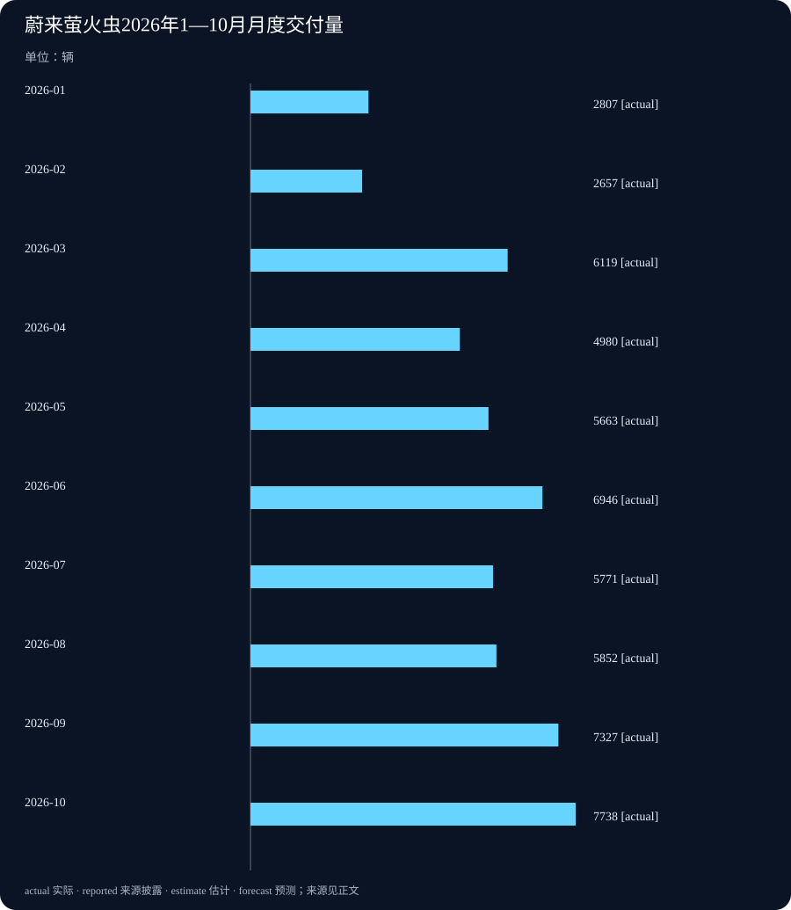

# Energy Intelligence · 读懂能源变化 — 2026-11-22（周六）

本期为历史补编稿：报道日期 2026-11-22，实际补编日期 2026-11-23。全文只使用截至 2026-11-22 已公开的材料，来源发布日期均落在 11 月 21 日或 22 日窗口内；引言与背景材料单独注明更早的发布时间，不以之后的消息冒充当时已知。

## Today's Thesis

能源转型的竞争重心正在从「单点产品」转向「链条与曲线」。国内电力交易进入按小时谈曲线的精细化阶段，充电与储能资产的价值将被重新定价；出海竞争则考验企业把技术、产能与合规链条整体落地的能力，而非单一车型的性价比。

## Executive Summary

- 充电基础设施：截至 2026 年 10 月底全国充电枪总数 2539.1 万个，同比增长 36.2%；私人桩 2010.8 万个、增速 42.5%，显著快于公共桩的 16.5%，增量结构继续向私人侧倾斜。
- 电力市场化：新能源全面入市后，电力交易从「谈一个价格」转向「谈曲线」，2025 年国网经营区新能源市场化交易电量首次突破万亿千瓦时，售电与聚合能力成为新门槛。
- 出海双线：蔚来萤火虫 Haven 特别版在奥斯陆完成欧洲首秀，10 月交付 7738 辆再创月度新高；同一天，荷兰法院对比亚迪 Ti7 发出欧盟临时销售禁令，出海合规风险显性化。
- 技术前沿：小鹏汇天 A868 完成全尺寸倾转过渡试飞，成为中国第一家；固态电池蓝皮书给出混合固液 2026 年出货 11.4GWh 的预期，全固态成本仍是量产拦路虎。
- 竞对静默：特锐德/特来电、星星充电、云快充、能链智电在 11 月 21—22 日窗口内均无新增公开动态。

## Policy Daily

周末官方渠道无新增政策文件发布，政策线索集中在市场化改革的落地纵深。据 21 世纪经济报道 11 月 21 日报道（https://m.21jingji.com/article/20261121/herald/c60afaefc4a30c01fe74ad51bd838062.html ），在 11 月 19 日成都举行的电力市场论坛上，「算小时」成为高频词：136 号文（2025 年发布，此处仅作背景）推动新能源全面入市后，交易颗粒度从年度、月度合约细化到小时级曲线，四川通威绿能电力总经理宋晶晶的判断是「以前只是谈一个价格，未来是要谈曲线的。」报道披露，2025 年国家电网经营区新能源市场化交易电量达 10718 亿千瓦时，首次突破万亿；差价结算机制（CfD）与虚拟电厂聚合入市是与会者关注的两大制度接口。对充电运营商与储能投资方而言，这意味着收益模型将从固定价差转向曲线管理能力的比拼。需要说明：上述数据为报道口径，136 号文原文不在本期来源窗口内，仅作制度背景引用。

## Market Daily

充电设施结构：财联社 11 月 21 日汽车早报（https://www.cls.cn/detail/2540726 ）援引国家能源局 11 月 20 日发布的数据，截至 2026 年 10 月底全国充电枪总数 2539.1 万个，同比增长 36.2%；其中公共充电枪 528.3 万个，同比增长 16.5%，额定总功率 2.71 亿千瓦，单枪平均功率约 51.37 千瓦；私人充电枪 2010.8 万个，同比增长 42.5%，报装容量 1.71 亿千伏安。私人桩贡献了绝大部分增量，公共网络的看点转向单枪功率与利用率。

固态电池：同一早报披露，第十一届动力电池应用国际峰会发布《2026 中国固态电池行业发展蓝皮书》，混合固液电池已完成全产业链交付闭环，2026 全年出货预计 11.4GWh；全固态完成车规级样件验证但未达量产门槛，电芯单价 2.80 元/Wh，远高于高端车型可接受的 1.10 元/Wh，2027—2028 年毛利率将分化。

整车与出海：零跑三季度营收 317 亿元、同比增长 63%，全球交付超 31 万辆，前三季度净利 2.5 亿元，毛利率 10.9%；零跑与欧宝签署协议共同开发 C 级 SUV，采用零跑核心零部件，在西班牙萨拉戈萨工厂生产，预计 2028 年开售。蔚来萤火虫 Haven 特别版 11 月 21 日经官方 App 宣布在奥斯陆 SNØ 室内滑雪馆完成欧洲首秀，计划 2027 年春在欧洲上市，欧洲定价未公布；10 月交付 7738 辆，同比增长 30.89%，连续第二个月创月度新高，2026 年前十个月累计交付 55860 辆（CnEVPost，11 月 22 日，https://cnevpost.com/2026/11/22/nio-firefly-debuts-haven-edition-oslo-spring-2027-launch-europe/ ）。

出海合规：CnEVPost 11 月 22 日报道（https://cnevpost.com/2026/11/22/dutch-court-bars-eu-sales-byd-ti7-land-rover-defender-design/ ），海牙地区法院周五裁定比亚迪 Ti7（国内方程豹钛7）侵犯捷豹路虎卫士 110 的欧盟外观设计权，发出临时禁令，禁止在欧盟进口、制造、销售与交付该车型，并禁止匈牙利工厂生产，罚金上限 1000 万欧元；禁令不覆盖英国市场。比亚迪声明车型系独立设计、强烈反对裁决并将上诉；JLR 须在 6 个月内提起实体诉讼，否则禁令可能失效。钛7 截至 10 月底累计销量 309456 辆，是方程豹的销量支柱，本案对「爆款车型全球化」的合规前置提出警示。

低空电动化：快科技 11 月 22 日消息（https://news.mydrivers.com/1/1167/1167606.htm ），小鹏汇天全尺寸全倾转电动飞行汽车 A868 完成倾转过渡试飞，即从垂直起降完整转换为高速平飞，为中国第一家完成该环节的企业。A868 采用六旋翼全倾转固定翼布局，搭载鲲鹏超级增程架构与自研航空级混电内核，设计续航超 500 公里、最大航速超 360 公里/小时，2+2+2 六座，1:1 原型机整机重 2.4 吨；全球范围内此前仅 Joby 等少数企业攻克全倾转路线。

上游金属：SMM 11 月 22 日发布的基本金属长单展望（https://news.smm.cn/news/P6GMVHSY6DKZSOAT3BNSABNACAFRWQLJESQZ6ZQ ）指出，2026 年铜价受 AI 需求预期降温与宏观压制先扬后抑，铝价 10 月内强外弱、重心下移；2026 年 Codelco 对中国长单溢价反超欧洲、居全球首位，锌长单溢价上浮扩大，中东减产推高亚洲铝长协溢价，中原铝锭贸易定价转向「基差+期权组合」。资源议价权继续向中国市场倾斜，电缆与桩体成本的长单锚也在变化。

## Competitor Watch

今日无新增公开动态。检索范围：特锐德（300001）公告与特来电官网、星星充电官网新闻页、云快充与能链智电公开报道，时间窗口限定 2026 年 11 月 21—22 日。星星充电官网最近的新闻为 11 月 5 日的获奖稿，均在窗口之外；特锐德未见窗口内交易所公告。周末静默属正常节奏，下周一恢复跟踪。

## Signal Dashboard

- 事实：私人桩同比增速 42.5%，约为公共桩 16.5% 的 2.6 倍。推断：补能增量主战场在家庭与目的地场景，公共运营商须靠快充功率与运营效率守住份额。
- 事实：公共充电枪单枪平均功率约 51.37 千瓦。推断：相对 800V 车型需求仍有明显升级空间，大功率改造是确定性投资方向。
- 事实：全固态电芯 2.80 元/Wh，约为高端车型可接受上限 1.10 元/Wh 的 2.5 倍。推断：2027 年前全固态难以上量，混合固液是过渡期主力。
- 事实：荷兰法院对比亚迪 Ti7 发出欧盟临时禁令并波及匈牙利产能。推断：外观设计合规将成为中国车企出海的前置成本项。
- 事实：Codelco 对中国铜长单溢价全球居首。推断：上游资源方对中国需求的依赖加深，长单谈判窗口对中国买方并非单向不利。

## Deep Insight

把本期两条主线放在一起看，会发现同一个关键词：从「产品」到「结构」。国内市场上，电力交易的计价对象正在从电量变成曲线。136 号文之后，新能源全面入市把「发多少电」的问题改写为「什么时候发电、什么时候用电」的问题，10718 亿千瓦时的市场化交易电量只是起点，真正的分水岭在于谁能管理小时级的形状风险。售电公司、虚拟电厂聚合商与充电运营商的资产边界因此变得模糊：一张充电网本质上是一组可调节负荷，叠加储能后就是可交易的曲线资产。单枪 51.37 千瓦的平均功率与 2010.8 万个私人桩，意味着聚合的原材料已经足够庞大，缺的是把分散资源组织成可结算曲线的制度接口与商业主体。这正是「谈曲线」对充电行业的真实含义——设备折旧之外，运营能力开始直接定价。

国际市场上，链条的完整性取代单点性价比成为竞争单位。SMM 在 11 月 18 日发布的 ASSS 2026 会议综述（https://news.metal.com/newscontent/3ZY76GHI4UNPMD5XLZ5TVCWIOMKGS2VUQXMHRKY-smm-conference-asss-2026-bringing-indonesias-solar-storage-ecosystem-together-to-turn-targets-into-projects ）里，其 CEO Logan Lu 用一句话概括了这种转变：能源转型不是买来的产品，而是建起来的链条。印尼的例子很典型：RUPTL 2025—2034 规划新增光伏 17.1GW，还有 100GW 国家光伏计划在议，而 2025 年底装机只有约 1.5GW——目标与落地之间隔着的不是政策，而是融资结构、本地含量合规与供应链交付能力；离岛柴油电成本高达每千瓦时 0.30—0.50 美元以上，光储柴混合微电网可削减六到七成燃料消耗，但前提是有人把组件、电芯、逆变器和运维组织成可融资的项目。中国企业的三种出海姿势恰好构成对照：零跑向欧宝输出工程开发服务、把技术嵌进对方的产能与品牌链条；萤火虫用特别版与北欧五周年叙事经营品牌纵深；而比亚迪 Ti7 的欧盟禁令则提醒，链条里最容易被忽视的一环是知识产权合规——它可以让销量支柱车型在整个欧盟市场瞬间停摆。曲线与链条，一个向内要效率，一个向外要组织能力，二者共同定义了能源行业下一阶段的竞争门槛。

## Tomorrow Watch

以下为截至 11 月 22 日已公开的日程预告，非既成事实：11 月 23 日（周一）欧拉 7 上市；11 月 24 日比亚迪第三代唐上市、吉利银河 M8 开启预售；11 月 25 日小鹏 AI Day（聚焦物理 AI）与理想汽车三季度财报；11 月 27 日广州车展零跑新款 Lafa 5 上市。数据面关注 SMM 锂电快讯周一复刊、充电联盟与动力电池联盟的月度口径更新，以及比亚迪对荷兰裁决的正式回应。

## One Chart

蔚来萤火虫 2026 年 1—10 月月度交付量（单位：辆）。3 月冲高后 4 月回落，随后逐月爬升，9 月 7327 辆、10 月 7738 辆连续创月度新高，与 Haven 特别版的节奏运营相互印证。数据来源：CnEVPost 2026-11-22（https://cnevpost.com/2026/11/22/nio-firefly-debuts-haven-edition-oslo-spring-2027-launch-europe/ ）。

## Quote of the Day

"The energy transition is not a product you buy. It is a chain you build."

能源转型不是一件买来的产品，而是一条建起来的链条。

—— Logan Lu（上海有色网 SMM CEO），11 月 10 日雅加达 ASSS 2026 东盟光储峰会开幕致辞。引语出自 SMM 2026-11-18 会议综述（发布于窗口前，作背景引言）：https://news.metal.com/newscontent/3ZY76GHI4UNPMD5XLZ5TVCWIOMKGS2VUQXMHRKY-smm-conference-asss-2026-bringing-indonesias-solar-storage-ecosystem-together-to-turn-targets-into-projects

## Action Items

1. **曲线定价能力** 评估自有充电与储能资产接入小时级交易/虚拟电厂的可行性，梳理所在省份的结算规则。
2. **公共桩功率升级** 对照单枪 51.37 千瓦的行业均值，盘点低功率存量桩的改造优先级与投资回收期。
3. **出海合规前置** 新车型立项即启动目标市场外观设计与知识产权检索，参考 Ti7 案的 6 个月实体诉讼窗口。
4. **固态电池节奏** 混合固液 2026 年 11.4GWh 出货预期下，锁定过渡期供应；全固态按 2027—2028 观察窗管理预期。
5. **周一日程跟踪** 关注欧拉 7 定价、比亚迪对荷兰裁决的回应与 SMM 周度数据复刊，及时更新竞对与成本假设。
