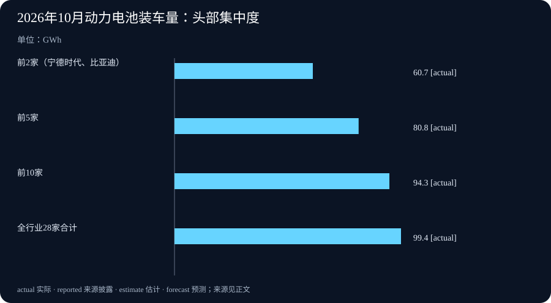

# Energy Intelligence · 读懂能源变化 — 2026-11-23 能源日报（创刊号）

日期：2026-11-23（周一，Asia/Shanghai）。本期为创刊号，覆盖政策、市场与竞对三条线，全部来源均经当日实际访问核验，核验记录见研究档案。

## Today's Thesis 今日论点

能源行业的定价逻辑正在从「装机规模」转向「系统价值」：虚拟电厂调节能力提前撞线 2027 年目标，机构确认独立储能经济性拐点临近，而整车端的价格战与账款压力正把利润向电池头部与调节资源环节再分配。读懂这场重定价，比追逐单日股价波动更重要。

## Executive Summary 执行摘要

- 港股汽车股周一早盘走弱：零跑汽车盘中跌 13.06%，小鹏汽车跌 8.36%，理想汽车跌 6.46%，Q3 盈利分化与供应商账款问题成为焦点（[财联社](https://www.cls.cn/detail/2541200)）。
- 零跑 Q3 营收 317.0 亿元、同比增 63.0%，但净利润仅 0.4 亿元；小鹏 Q3 净亏损 8.7 亿元，同比扩大；中汽协已启动 17 家重点车企供应商账款支付调研（[财联社](https://www.cls.cn/detail/2541308)）。
- 中信证券研报判断国内独立储能经济性拐点将至：前 9 个月新型储能新增装机 111GWh、同比增 87%，碳酸锂较 5 月高点回落超 10 万元/吨，系统运行费分摊优化写入「十五五」新型储能规划（[SMM 11.23 锂电快讯](https://news.smm.cn/news/UYCSJXLH2RKGXZLOBI2CBYLTA2EJKMXS5S6IT4Y)）。
- 国家能源局解读首部国家级虚拟电厂报告：截至 6 月底全国 592 个项目、最大调节能力 2042.8 万千瓦，提前实现 2027 年不低于 2000 万千瓦的目标（[国家能源局](https://www.nea.gov.cn/20261119/7504b3489a694054920e81f18fc3072f/c.html)）。
- 10 月动力电池装车 99.4GWh，前 2 家占 61.1%、前 10 家占 94.9%，格局进一步固化（[国际充换电网](https://mchd.in-en.com/html/chd-2463389.shtml)）；全国充电设施总量达 2539.1 万枪、同比增 36.2%（[国家能源局](https://www.nea.gov.cn/20261120/b5c5d572988c4171982367855f9a1b26/c.html)）。

## Policy Daily 政策动态

本期政策主线是虚拟电厂的规模化确认。国家能源局 11 月 19 日刊发电力规划设计总院凡鹏飞对《中国虚拟电厂发展报告（2026）》的解读：这是首部国家级虚拟电厂报告，截至 2026 年 6 月底全国虚拟电厂项目 592 个、同比增长 78.9%，最大调节能力 2042.8 万千瓦、同比增长 62.7%，提前实现 2027 年不低于 2000 万千瓦的既定目标；2026 年 6 月印发的《新型电力系统建设「十五五」规划》首次将虚拟电厂纳入，2030 年目标超过 5000 万千瓦；23 个省份已出台专项文件，民企投资占比 45.3%，《虚拟电厂管理规范》等 3 项国标推进中，广州聚合充电站化解主变重载、车网互动放电等场景被点名（[国家能源局解读原文](https://www.nea.gov.cn/20261119/7504b3489a694054920e81f18fc3072f/c.html)）。

储能侧的政策增量来自今日 SMM 快讯对中信证券研报的转述：系统运行费分摊机制优化已写入「十五五」新型储能规划，多省将系统运行费纳入分时波动，独立储能的成本疏导路径正在打通；研报同时提示锂电消费税落地后的行业出清效应，2027 年一季度为过渡期（[SMM](https://news.smm.cn/news/UYCSJXLH2RKGXZLOBI2CBYLTA2EJKMXS5S6IT4Y)）。背景框架上，「十五五」新型储能实施方案（发改能源〔2026〕1565 号，10 月 29 日印发、11 月 13 日公开）与 2025 年新能源上网电价市场化改革（136 号文）等存量文件仍是现货价格与调节资源定价的底层约束，本期仅作背景、不展开条款。政策工具层面，崔东树 11 月 22 日披露 1–11 月新能源车免税目录共 23228 款、11 月新增 243 款且较年均水平大幅下滑，反映购置税优惠目录节奏收紧（[财联社汽车早报](https://www.cls.cn/detail/2541149)）。如实说明：11 月 22–23 日为周末至周一早盘，发改委与能源局官网暂无可核验的新发政策文件，部委原文最新为 11 月 19 日解读。

## Market Daily 市场动态

整车盈利与股价（11-23 新鲜）。财联社早盘报道，零跑汽车（09863.HK）盘中跌 13.06%，小鹏汽车（09868.HK）跌 8.36%，理想汽车（02015.HK）跌 6.46%（[财联社](https://www.cls.cn/detail/2541200)）。业绩层面，零跑 Q3 营收 317.0 亿元、同比增 63.0%、环比增 16.2%，毛利率 10.9%（去年同期 14.5%、Q2 为 12.6%），净利润 0.4 亿元（去年同期 1.5 亿元、Q2 为 6.0 亿元），9 月末在手资金 391.4 亿元；小鹏 Q3 营收 242.8 亿元、同比增 19.1%，交付 11.84 万辆、同比仅增 2.1%，净亏损 8.7 亿元（去年同期亏 3.8 亿元）。中汽协口径 1–10 月汽车产销 2631.8 万/2628.6 万辆、同比下降 5.0%/5.1%，新能源产销 1450.9 万/1441.1 万辆、同比增 11.5%/11.3%，占新车总销量 54.8%；11 月 16 日中汽协启动 17 家重点车企供应商账款支付调研，小鹏 2026 上半年应付账款及票据周转天数 231.4 天，较 2025 年末拉长 61.4 天（[财联社](https://www.cls.cn/detail/2541308)）。

储能与锂电（11-23 新鲜）。SMM 快讯援引中信证券研报：CESA 口径 2026 年前 9 个月国内新型储能新增装机 111GWh、同比增 87%；碳酸锂价格较 2026 年 5 月高点下跌超 10 万元/吨，叠加系统运行费分摊优化，判断独立储能经济性边际改善、拐点将至。亿纬锂能董事长刘金成表示，锂电消费税落地后相当一部分企业将退出（援引铅酸电池加征 10% 消费税后 90% 铅酸企业退出的历史），建议寻找创新细分市场。崔东树数据显示 10 月锂电池出口 110 亿美元、同比增 57%，10 月汽车出口 197 亿美元、同比增 38%。宁德时代全资子公司福宁时代注册资本由 30 亿元增至 50 亿元（[SMM 11.23 锂电快讯](https://news.smm.cn/news/UYCSJXLH2RKGXZLOBI2CBYLTA2EJKMXS5S6IT4Y)）。另据财联社汽车早报：崔东树 11 月 22 日披露 1–11 月新能源车免税目录 23228 款，11 月新增 243 款、较年均水平大幅下滑；小鹏汇天 A868 全尺寸全倾转电动飞行汽车 11 月 22 日完成倾转过渡试飞；雷克萨斯 ES 纯电版上市 33.99 万元起，搭载宁德时代三元电芯与 SiC 电控，CLTC 最高 707km（[财联社汽车早报](https://www.cls.cn/detail/2541149)）。

动力电池结构（背景，11-19/20 发布）。中国汽车动力电池产业创新联盟数据：10 月装车 99.4GWh、环比增 14.0%、同比增 18.2%；1–10 月累计 675.6GWh、同比增 16.9%；配套企业 28 家、同比少 5 家；前 2/5/10 家装车 60.7/80.8/94.3GWh，占比 61.1%/81.3%/94.9%，前五为宁德时代、比亚迪、中创新航、国轩高科、亿纬锂能（[国际充换电网](https://mchd.in-en.com/html/chd-2463389.shtml)）。化学体系上，10 月三元装车 12.8GWh、占 12.9%、同比降 22.8%；磷酸铁锂 86.3GWh、占 86.9%、同比增 27.8%（[生意社](https://www.100ppi.com/news/detail-20261119-6518013.html)）。

充电基础设施（背景，11-20 发布）。国家能源局月度数据：全国充电设施总量 2539.1 万枪、同比增 36.2%；公共桩 528.3 万枪、同比增 16.5%，额定总功率 2.71 亿千瓦，单枪平均约 51.37 千瓦；私人桩 2010.8 万枪、同比增 42.5%，报装容量 1.71 亿千伏安（[国家能源局](https://www.nea.gov.cn/20261120/b5c5d572988c4171982367855f9a1b26/c.html)）。

海外与技术（背景）。SMM 英文站报道，美国储能需求拉动韩国电池厂稼动率回升：LG 新能源 57.1%（提升 9.5 个百分点）、三星 SDI 78%、SK On 36.4%；BNEF 将美国 ESS 装机预测上调至 2026 年 91GWh、2027 年 97GWh（分别上调 41%/45%）；三星 SDI 美国订单超 60GWh，LG 新能源在手订单约 160GWh（[SMM 英文](https://news.metal.com/newscontent/VRY334H7LZBQ4PPDR4CAEG2YGI3KQ5IRVSU3VGY-us-energy-storage-demand-boosts-korean-battery-makers-factory-utilization)）。专利结构上，Appleyard Lees 年度报告显示 2024 年全球固态电池专利申请 2230 件、同比增 16% 创纪录，首次超过锂离子电池（2092 件、降约 15%）；韩国 873 件超越日本 605 件，三星 SDI 申请量从 165 件增至 325 件；中国固态优先权申请 217 件、较 2022 年翻倍以上（[pv magazine](https://www.pv-magazine.com/2026/11/21/battery-patents-solid-state-filings-surpass-lithium-ion-to-hit-record-high/)）。

## Competitor Watch 竞对观察

今日无新增公开动态。截至发稿，特来电、星星充电、云快充三家在 11 月 22–23 日均未检索到可核验的新增公开新闻或公告（检索范围：搜索引擎公开结果、财经媒体与行业媒体；未访问需登录渠道，官网新闻页未见当日更新）。背景观察：行业层面，公共桩 528.3 万枪、单枪平均功率约 51.37 千瓦的存量结构意味着运营商竞争焦点正从枪数扩张转向功率利用率与调节资源变现；国家能源局虚拟电厂报告点名的广州聚合充电站化解主变重载、车网互动放电场景，正是头部运营商向聚合商转型的可复制路径。明日继续跟踪三家官方渠道、招标公告与母公司公告面。

## Signal Dashboard 信号看板

- 独立储能经济性：机构确认拐点临近，成本端碳酸锂回落超 10 万元/吨＋政策端系统运行费疏导，中期偏多。
- 整车盈利分化：零跑净利环比大幅收窄至 0.4 亿元、小鹏亏损扩大至 8.7 亿元，短期偏空，价格战仍在侵蚀利润。
- 供应链账款：中汽协 17 家车企调研＋小鹏周转天数拉长 61.4 天，产业链现金流风险信号，需持续跟踪。
- 电池集中度：CR2 达 61.1%、CR10 达 94.9%，配套企业同比减少 5 家，格局固化信号。
- 充电结构：私人桩增速 42.5% 显著快于公共桩 16.5%，公共运营利用率承压的结构性信号。
- 海外储能：韩国三厂稼动率回升、美国 ESS 预测大幅上调，外需偏多。
- 技术专利：固态申请量首超锂离子，长期技术替代信号，短期不影响铁锂主导格局。

## Deep Insight 深度洞察

本期创刊号把多条线索放在一起，可以看到一个共同命题：中国能源转型正在从「装机竞赛」进入「系统价值竞赛」，利润与估值将按调节能力而非单纯规模重新分配。

第一，调节资源从概念变成可计价的资产。虚拟电厂最大调节能力 2042.8 万千瓦、提前一年半撞线 2027 年目标，且民企投资占比已达 45.3%，说明这不是电网侧的独角戏，而是社会资本可以进入的市场。23 省专项文件与 3 项国标推进，意味着聚合商的准入门槛、计量与结算规则正在标准化——对充电运营商而言，2539.1 万枪的存量网络第一次有了除充电服务费之外的第二种变现通道：把分散的充电桩、储能与可调负荷打包成电网愿意付费的调节能力。广州聚合充电站化解主变重载的案例之所以被官方报告点名，正是因为它证明了这条路径在配网层面真实可行。

第二，储能的盈利函数正在被政策与成本同时改写。前 9 个月新增装机 111GWh、同比增 87% 的高增长，过去主要靠强制配储与容量租赁支撑；而中信证券此次提示的边际变化是系统运行费分摊优化写入「十五五」规划、多省纳入分时波动——这是把独立储能从「成本项」转为「有疏导机制的经营性资产」的关键一步。叠加碳酸锂自 5 月高点回落超 10 万元/吨，初始投资与运营成本双降，独立储能 IRR 的改善是结构性的而非情绪性的。但必须提示另一面：刘金成关于消费税出清的判断（参照铅酸行业 90% 企业退出的历史）意味着 2027 年过渡期前后，电池与储能集成环节将出现一轮残酷洗牌，经济性拐点属于活下来的头部，不属于全行业。

第三，整车端的利润塌陷正在向上游传导。零跑营收增 63% 而净利只剩 0.4 亿元、毛利率从 14.5% 滑到 10.9%，小鹏交付仅增 2.1% 且亏损扩大，说明新能源渗透率 54.8% 之后，增量红利已不足以覆盖价格战成本。中汽协启动账款调研、小鹏周转天数拉长 61.4 天，是压力向供应链传导的明确证据。对照电池端 CR2 61.1%、前 10 家 94.9% 的集中度，以及固态专利首超锂离子的技术信号，可以判断：整车让渡的利润正流向两类主体——掌握规模与成本曲线的电池头部，以及掌握调节资源与系统入口的聚合商。对投资者与从业者，创刊号的结论是：跟踪「系统价值」的三个计价器——现货与辅助服务价格、系统运行费分摊细则、电池集中度与账款周期——比跟踪单月销量更能解释未来两年的利润分配。

## Tomorrow Watch 明日关注

- 11 月 24 日（周二）港股汽车股能否企稳，零跑、小鹏 Q3 业绩的市场消化是否延续。
- 锂电消费税过渡期（至 2027 年一季度）配套细则是否由财政部、税务总局发布，关注官方渠道。
- 中汽协 17 家重点车企供应商账款支付调研的进展与披露。
- 发改委、能源局「十五五」新型储能与新型电力系统规划的配套文件，尤其系统运行费分摊的省级落地。
- 特来电、星星充电、云快充官方渠道与招标公告，补齐竞对静默日。
- 乘联会周度零售与 11 月免税目录新增节奏，验证年末需求成色。

## One Chart 一图看懂

10 月动力电池装车 99.4GWh：前 2 家（宁德时代、比亚迪）60.7GWh、占 61.1%；前 5 家 80.8GWh、占 81.3%；前 10 家 94.3GWh、占 94.9%；全行业配套企业 28 家。数据来源：[国际充换电网《2026年1-10月国内动力电池企业装车量TOP15》](https://mchd.in-en.com/html/chd-2463389.shtml)（中国汽车动力电池产业创新联盟 11 月 19 日发布）。

## Quote of the Day 今日引言

> "appear to be consolidating, with filing numbers decreasing for a second consecutive year."
> — Chris Mason, Partner at Appleyard Lees

中文译文：（锂离子电池技术）似乎正进入整合期，专利申请量连续第二年下降。

出处：pv magazine 2026 年 11 月 21 日报道《Battery patents: Solid-state filings surpass lithium-ion to hit record high》，[原文链接](https://www.pv-magazine.com/2026/11/21/battery-patents-solid-state-filings-surpass-lithium-ion-to-hit-record-high/)。语境：知识产权机构 Appleyard Lees 第六份年度绿色创新报告显示，2024 年固态电池专利申请 2230 件创纪录并首次超过锂离子电池，合伙人 Chris Mason 作出上述判断。

## Action Items 行动项

1. **储能经济性拐点** 复核中信证券对独立储能收益的假设，逐省跟踪系统运行费分摊细则落地
2. **整车盈利分化** 对比零跑与小鹏 Q3 毛利率、周转天数，评估价格战向供应链传导的账款风险
3. **充电运营转型** 测算公共桩功率利用率与虚拟电厂聚合收益，评估广州车网互动场景的可复制性
4. **固态电池节奏** 跟踪三星 SDI 与头部中企固态专利及中试进展，校准 2027–2030 技术替代假设
