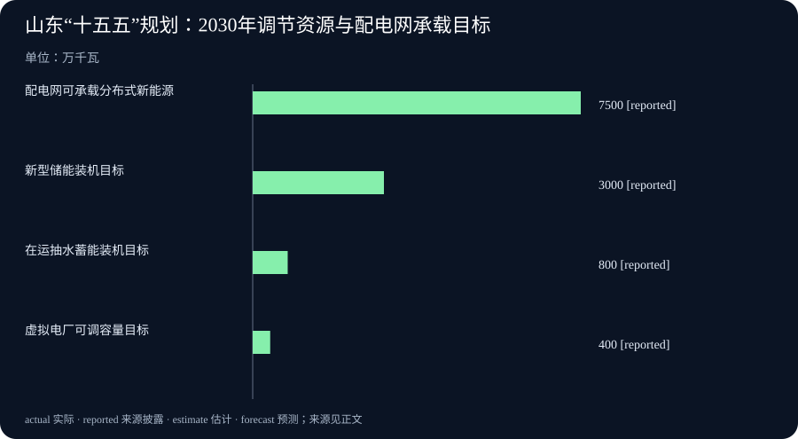

# Energy Intelligence · 读懂能源变化 — 2026-11-25 能源日报

日期：2026-11-25（周三，Asia/Shanghai）。本期覆盖新能源新增建档立卡结构、山东与交通两部"十五五"规划、构网储能并网验证装置、甘肃储能并网与中标、充电设备集采、海外储能交付与英国分区采购六条线。全部来源均于本日早间实际访问并核对原文；披露日与事件发生日不同的，正文同时标注（国家能源局公告制发于 11 月 24 日、统计口径为 10 月；山东发布会召开于 11 月 23 日；《绿色交通发展"十五五"规划》文件落款 2026 年 8 月 10 日、转载稿导语称 11 月 20 日印发，本期按公开披露日计入；智光模拟装置发布于 11 月 20 日、企业稿 11 月 24 日刊发；铁塔天津分公司中标候选公示日期为 11 月 18 日；Fluence 财报期间截至 2026 年 9 月 30 日、高管调整宣布于 11 月 2 日）。

## Today's Thesis 今日论点

能力必须先过"可验证"这一关，才谈得上被定价。11 月 24 日披露的三件事落在同一条线上：智光电气的 5 兆瓦构网储能接入电网短路比模拟装置，把"弱电网支撑"变成短路比 1 至 10 之间可复现的试验条件（[装置发布](https://mchuneng.in-en.com/html/chunengy-60278.shtml)）；英国国家电网运营商 NESO 拟把辅助服务日前拍卖拆成 12 个分区，同一项服务可以在不同分区清算出不同价格（[NESO 方案](https://www.ess-news.com/2026-11-24/uk-grid-operator-plans-locational-procurement-for-ancillary-services/)）；Fluence 在手订单创下 89 亿美元纪录的同时承认收入不及预期，主因是合同制造工厂爬坡造成的发货延迟（[Fluence 报道](https://www.ess-news.com/2026-11-24/fluence-reports-8-9-billion-order-backlog-revenue-hit-by-shipment-delays/)）。规划端同向：山东把 7500 万千瓦分布式新能源与 450 万个充电设施的配电网接入能力、3000 万千瓦新型储能与 400 万千瓦虚拟电厂可调规模写成 2030 年指标（[发布会实录](https://mchd.in-en.com/html/chd-2463415.shtml)）；国家能源局 10 月新增建档立卡新能源项目 3218 个，其中 3162 个是工商业分布式（[能源局公告](https://www.nea.gov.cn/20261124/a4cfe5ac7f8440b2a2376b428dffd2da/c.html)）。昨日的问题是"谁来核验构网溢价"，今天的答案开始成形：检验装置、分区科目与承载力指标同时出现，行业的稀缺项正从"拿到订单"转向"证明并交付能力"。

## Executive Summary 执行摘要

- 国家能源局 11 月 24 日发布《关于 2026 年 10 月全国新增建档立卡新能源发电（不含户用光伏）项目情况的公告》：当月新增 3218 个项目，风电 22 个、光伏 3194 个（集中式 32 个、工商业分布式 3162 个）、生物质 2 个；广东 1120 个、江苏 423 个、山东 389 个、浙江 286 个、云南 155 个，前五省合计 2373 个、占全国的 73.7%（[公告原文](https://www.nea.gov.cn/20261124/a4cfe5ac7f8440b2a2376b428dffd2da/c.html)）。
- 山东省政府新闻办 11 月 23 日举行"开局起步'十五五'"主题发布会解读《山东省新型能源体系建设"十五五"规划》：到 2030 年配电网具备 7500 万千瓦分布式新能源、450 万个充电基础设施接入能力，新型储能装机 3000 万千瓦左右、在运抽水蓄能 800 万千瓦左右、虚拟电厂可调规模 400 万千瓦以上，新能源利用率保持在 90% 以上，非化石能源发电装机达到 2 亿千瓦左右（[发布会实录](https://mchd.in-en.com/html/chd-2463415.shtml)）。
- 交通运输部、国家铁路局、中国民用航空局、国家邮政局四部门《绿色交通发展"十五五"规划》要求推动公路沿线源网荷储充一体化、鼓励清洁能源开发同步配套新型储能：打造甘肃河西走廊、京新高速、青银高速等光储充一体化公路走廊，推动山东、云南、江苏、广东等省份建设全域公路与能源融合发展区，新增非化石能源发电装机容量 600 万千瓦以上；开展充电设施服务能力"三年倍增"行动，到 2030 年民用运输机场场内车辆力争全面电动化、沿海港口多式联运港区铁路进港率达 80%、"一箱制"集装箱铁水联运量达 1000 万标箱（[规划转载](https://mchuneng.in-en.com/html/chunengy-60271.shtml)）。
- 验证能力开始设备化：智光电气技术 5 兆瓦构网储能接入电网短路比模拟装置 11 月 20 日发布，可在短路比 1 至 10 的宽范围内模拟电网强弱、破解弱电网测试难题，采用环氧浇筑高压铁心电抗器；企业稿援引的口径是截至今年 9 月底我国风电光伏累计装机突破 20 亿千瓦（[装置发布](https://mchuneng.in-en.com/html/chunengy-60278.shtml)）。
- 甘肃储能并网与中标同步：易事特武威凉州区九墩滩 200MW/800MWh 独立储能项目并网成功，采用自研 6.7MW/26.8MWh 液冷集成单元，电芯温差控制在 3 摄氏度以内、PCS 最高转换效率 99%、循环寿命 8000 次以上（[并网披露](https://mchuneng.in-en.com/html/chunengy-60265.shtml)）；水电一局连续中标渭源县与兰州市榆中县各 200MW/800MWh 独立储能 EPC，合计 400MW/1600MWh，榆中需新建 330 千伏储能汇集站 1 座、240MVA 主变 1 台与 8 回 35 千伏集电线路（[中标披露](https://mchuneng.in-en.com/html/chunengy-60270.shtml)）。
- 海外两条信号互为注脚：Fluence 截至 2026 年 9 月 30 日在手订单 89 亿美元（上年同期 53 亿美元）、订单功率由 9.1 吉瓦增至 16.8 吉瓦、增幅 84.6%，而营收 23 亿美元与上年持平、净亏损 2.739 亿美元，休斯顿工厂日产约 10 台集成单元；NESO 提议在日前辅助服务拍卖中引入 12 个分区（苏格兰 3 区、英格兰与威尔士 9 区），咨询期截至 2027 年 1 月 8 日（[Fluence](https://www.ess-news.com/2026-11-24/fluence-reports-8-9-billion-order-backlog-revenue-hit-by-shipment-delays/)、[NESO](https://www.ess-news.com/2026-11-24/uk-grid-operator-plans-locational-procurement-for-ancillary-services/)）。

## Policy Daily 政策动态

**3218 个新增项目里 3162 个是工商业分布式**
国家能源局 11 月 24 日发布的公告显示，2026 年 10 月全国新增建档立卡新能源发电（不含户用光伏）项目共 3218 个，其中风电项目 22 个、光伏发电项目 3194 个（集中式光伏发电项目 32 个、工商业分布式光伏发电项目 3162 个）、生物质发电项目 2 个。工商业分布式占光伏新增项目数量的约 99.0%、占全部新增项目的 98.3%。分省结构更为集中：广东 1120 个（工商业分布式 1119 个、生物质 1 个）、江苏 423 个（集中式 7 个、工商业分布式 416 个）、山东 389 个（全部为工商业分布式）、浙江 286 个（全部为工商业分布式）、云南 155 个（集中式 3 个、工商业分布式 152 个）、湖南 133 个、安徽 120 个、福建 129 个、河北 106 个（风电 2 个、集中式 6 个、工商业分布式 98 个），河南当月新增为零；风电新增较多的省份为广西、河北与辽宁各 2 个。风电、集中式光伏与生物质项目清单随公告公布，工商业分布式清单需到国家可再生能源发电项目信息管理平台查询。这份月度统计的信息量不在总量而在结构：新增项目主体已从大基地与集中式电站转为用户侧屋顶与园区，行业的增长界面正从"外送与消纳"切换到"接入、计量与就地平衡"（[能源局公告](https://www.nea.gov.cn/20261124/a4cfe5ac7f8440b2a2376b428dffd2da/c.html)）。

**山东把"承载能力"写成 2030 年规划指标**
11 月 23 日，山东省人民政府新闻办公室举行"开局起步'十五五'"主题系列新闻发布会，省发展改革委党组副书记、省能源局党组书记兼局长郑德雁解读经省政府同意正式印发的《山东省新型能源体系建设"十五五"规划》。规划给出的约束性表述集中在配电网一侧：针对分布式新能源发展集中区域加大配电网投入、加快改造升级，针对高速公路服务区等电网薄弱环节适当预留电网容量以支撑电动重卡大功率充换电示范站，到 2030 年配电网具备 7500 万千瓦分布式新能源与 450 万个充电基础设施的接入能力；同期新型储能装机达到 3000 万千瓦左右、在运抽水蓄能 800 万千瓦左右、虚拟电厂可调规模 400 万千瓦以上，非化石能源发电装机达到 2 亿千瓦左右、全省发电装机超过 1.4 亿千瓦，并确保新能源利用率保持在 90% 以上。规划同时部署虚拟电厂、零碳园区、绿电直连试点，推广车网互动充换电示范站、扩大双向充放电项目规模，并持续完善分时电价机制。与"装机目标"相比，"接入能力"是可被观测、可被考核的物理量，这类指标进入省级规划，意味着配电网投资与调度能力成为新能源增长的先决条件（[发布会实录](https://mchd.in-en.com/html/chd-2463415.shtml)）。

**绿色交通"十五五"：交通廊道同时是电源与负荷**
交通运输部等四部门印发的《绿色交通发展"十五五"规划》把能源设施写进交通基础设施：因地制宜推进高速公路服务区、互通区域分布式光伏与风电开发，推动公路沿线源网荷储充一体化项目，鼓励清洁能源开发同步配套新型储能设施、推动绿电直连等就近消纳模式，推进老旧高速公路服务区外电扩容改造与智能微电网建设，加快光储直柔、虚拟电厂、车网互动等技术应用和集成示范。空间布局上，规划提出打造甘肃河西走廊、京新高速、青银高速等一批光伏发电和光储充一体化公路走廊，推动山东、云南、江苏、广东等省份和城市建设全域公路与能源融合发展区，新增非化石能源发电装机容量 600 万千瓦以上。补能网络方面，研究制定新能源重卡补能设施、船舶充换电及绿色燃料加注设施布局规划，开展电动汽车充电设施服务能力"三年倍增"行动，提高高速公路服务区大功率充电设施比重。运输结构调整给出三个可量化目标：到 2030 年"一箱制"集装箱铁水联运量达到 1000 万标箱、沿海港口多式联运港区铁路进港率达到 80%、民用运输机场场内车辆力争全面实现电动化。需注意的是，该文件落款日期为 2026 年 8 月 10 日，转载稿导语称 11 月 20 日印发，本期按行业媒体 11 月 24 日的公开披露计入，正文区分披露日与事件日（[规划转载](https://mchuneng.in-en.com/html/chunengy-60271.shtml)）。

## Market Daily 市场动态

- **验证设备：短路比 1 至 10 可复现。** 智光电气技术于 11 月 20 日发布 5 兆瓦构网储能接入电网短路比模拟装置，用于在不同电网强弱条件下考核构网型储能的接入表现，模拟短路比覆盖 1 至 10 的宽范围，核心部件采用环氧浇筑高压铁心电抗器；企业稿称该装置针对弱电网测试难题，并援引截至今年 9 月底我国风电光伏累计装机突破 20 亿千瓦作为背景。把"电网强度"做成可调试验条件，意味着构网性能的争议从现场表现前移到实验室验收（[智光电气股份](https://mchuneng.in-en.com/html/chunengy-60278.shtml)）。
- **并网：4 小时项目以温差与效率为卖点。** 易事特披露其位于甘肃武威凉州区九墩滩的 200MW/800MWh 独立储能项目并网成功，按 4 小时时长配置，采用自研 6.7MW/26.8MWh 液冷集成单元，电芯温差控制在 3 摄氏度以内，PCS 最高转换效率 99%，电芯循环寿命 8000 次以上。企业宣传口径中的效率与寿命指标尚需现场运行数据验证，但其指向明确：交付竞争正从容量规模转向系统可用率与运维成本（[易事特](https://mchuneng.in-en.com/html/chunengy-60265.shtml)）。
- **中标：水电一局拿下甘肃 400MW/1600MWh。** 水电一局连续中标甘肃省两个独立储能电站 EPC 总承包项目：定西市渭源县 200MW/800MWh 与兰州市榆中县 200MW/800MWh，合计 400MW/1600MWh，均采用组串式交直流一体化方案。渭源项目经 110 千伏线路接入 330 千伏秀峰变电站 110 千伏侧；榆中项目需新建 330 千伏储能汇集站 1 座、配置 240MVA 主变 1 台与 8 回 35 千伏集电线路，再送入既有 330 千伏汇集站。升压与汇集设施被写入承包范围，正是 EPC 单价与设备单价之间那道台阶的具体内容（[水电一局](https://mchuneng.in-en.com/html/chunengy-60270.shtml)）。
- **充电设备集采：折扣报价与前置备货成为门槛。** 铁塔能源有限公司天津分公司 2026 至 2027 年汽车充电桩补充采购 11 月 18 日公示中标候选人（行业媒体 11 月 24 日转载）：第一候选人山东积成智通新能源折扣报价 86%，第二候选人深圳市永联科技 86%，第三候选人深圳市盛弘电气 83%。项目采购交流充电桩、直流一体式与分体式充电桩及配件，不含税预算 540 万元，取 2 名中标人，第一名份额 60%（预估 324 万元不含税）、第二名 40%（预估 216 万元），并要求投标人前置仓库备货比例不低于招标标的的 10%、近三年同类设备销售业绩累计不少于 800 万元。央国企充电集采把评审落在折扣率与备货响应上，设备商而非运营商成为直接受益方（[充换电头条](https://mchd.in-en.com/html/chd-2463414.shtml)）。
- **运营资质目录化：六盘水公示首批充换电运营企业。** 11 月 23 日，贵州六盘水市能源局公示 2026 年第一批电动汽车充（换）电基础设施运营企业，当地公共交通有限公司列入名单，公示期满无异议即自动纳入全市充换电基础设施运营企业目录。公共交通主体进入运营目录，与"三年倍增"行动和地方大功率充电改造要求同向（[国际充换电网](https://mchd.in-en.com/html/chd-2463440.shtml)）。
- **海外交付瓶颈：89 亿美元订单对 23 亿美元收入。** Fluence 公布截至 2026 年 9 月 30 日财年业绩：在手订单达 89 亿美元、上年同期为 53 亿美元，订单功率从 9.1 吉瓦增至 16.8 吉瓦、增幅 84.6%，总项目管线 44.5 吉瓦/169.4 吉瓦时；同期营收 23 亿美元、与上年持平，净亏损 2.739 亿美元。公司把收入不及预期主要归因于一家合同制造工厂爬坡导致的发货延迟，其休斯顿工厂目前日产约 10 台集成单元。其他披露口径包括：累计部署 8.1 吉瓦/20.8 吉瓦时，美国市场占在手订单 70%、数据中心占 10%，7.5 兆瓦时 Smartstack 产品符合美国税收抵免条件，服务协议覆盖资产管理 6.9 吉瓦（上年同期 5.6 吉瓦）、服务订单储备 10.1 吉瓦，数字软件业务合同资产 24.1 吉瓦、年度经常性收入约 1.712 亿美元。11 月 2 日公司宣布管理层调整，前西门子高管 Axel Meier 出任临时首席执行官（[ESS News](https://www.ess-news.com/2026-11-24/fluence-reports-8-9-billion-order-backlog-revenue-hit-by-shipment-delays/)）。
- **海外规则：把网络位置变成拍卖科目。** 英国国家电网运营商 NESO 提议改造辅助服务拍卖机制，在其日前拍卖中引入位置采购，按输电网络关键边界划分 12 个分区（苏格兰 3 区、英格兰与威尔士 9 区），覆盖动态响应与备用市场；现行全国统一日前联合优化拍卖可能采购到因网络约束无法在需要时交付的容量，分区后同一项服务可能在受限时段的不同分区清算出不同价格。对新进入者与聚合单元，方案要求提交位置信息且单体与聚合单元须落在同一分区，既有参与者无需仅为提供位置信息重新完成入市流程。该提案正处于行业咨询阶段，反馈截止时间为 2027 年 1 月 8 日（[ESS News](https://www.ess-news.com/2026-11-24/uk-grid-operator-plans-locational-procurement-for-ancillary-services/)）。

## Competitor Watch 竞对动态

本期跟踪的三家充电主体——特来电（特锐德，300001）、星星充电（万帮数字能源）、云快充——在 11 月 24 日至 25 日均未检索到可核实的一手动态，按静默日处理，不计入来源。核查过程与结论：公告检索显示特锐德 11 月 15 日以来仅有三条公告，其中 11 月 23 日《关于公司预中标国网项目的提示性公告》与 11 月 20 日的董事会决议、员工持股解锁公告，11 月 24 日至 25 日无新增公告，昨日提到的"预中标"仍未转为正式中标确认，最终以公司公告为准；星星充电官网新闻列表最新条目停留在 11 月 6 日；云快充未见这两日的公开主体动态。行业侧有两条可替代信号：其一，天津铁塔充电桩补充采购的三名候选人全部是设备与电源厂商（积成智通、永联科技、盛弘电气），说明央国企充电集采的评审落点在折扣率与前置备货能力，运营商品牌不进入这一层竞价；其二，六盘水把充换电运营企业目录化，公共交通企业成为首批列入主体，运营资质正成为地方公共事业主体的常规业务选项。需要说明的是，中国充电联盟 10 月运营商月充电电量 TOP15 榜单发布于 11 月 23 日、昨日已作为来源使用，本期仅作背景引用：该榜特来电、云快充、星星充电列第 2 至第 4 位，广汽能源、蔚来等整车主体与南方电网已进入前 15。

## Signal Dashboard 信号看板

- 结构偏配置：10 月新增建档立卡项目中 3162 个为工商业分布式、占全部新增的 98.3%，且前五省集中度达 73.7%，利好配网改造、园区微电网、计量与接入服务环节。
- 承载力成为规划科目：山东把 7500 万千瓦分布式与 450 万充电桩的接入能力、3000 万千瓦新型储能、400 万千瓦虚拟电厂可调容量写入 2030 年指标，并把新能源利用率 90% 作为约束，方向偏多配网投资与可调资源运营。
- 交通廊道成为新场景：公路与能源融合发展区新增非化石能源装机 600 万千瓦以上、服务区大功率充电与"三年倍增"行动，为充电设备与光储充一体化总包打开增量，但需盯住落地资金与电价机制。
- 验证能力稀缺化：5 兆瓦、短路比 1 至 10 的接入模拟装置出现，意味着构网性能验收走向第三方试验台；检测机构与具备涉网试验业绩的厂商议价能力上升。
- 交付成为独立风险项：Fluence 订单 89 亿美元对营收 23 亿美元、净亏 2.739 亿美元、合同制造延迟、休斯顿工厂日产约 10 台，说明储能行业的收入确认瓶颈已从签约转向制造与物流。
- 位置信号开始定价：NESO 的 12 分区方案会让同一服务在不同分区清算出不同价格，对电网阻塞区域的存量电池是收益上行机会，对聚合商则新增单一分区的注册约束。
- 集采口径变化：天津铁塔以折扣率（86%、86%、83%）与前置备货 10% 作为评审要素，540 万元预算级别的小包件同样要求 800 万元三年业绩，设备端份额向具备库存与资金占用的厂商集中。

## Deep Insight 深度洞察

**从拿到订单到证明能力：验证、分区与承载力同期成形**

昨日的问题是"谁来核验"。今日出现的三份材料没有一份直接回答定价，却共同改变了定价的前提。智光电气把构网储能的接入表现变成一台可以调节的设备：5 兆瓦容量、短路比 1 至 10 的模拟范围、环氧浇筑高压铁心电抗器，电网强弱不再是投运后才被发现的现场条件，而是招标技术条款可以引用的试验坐标。NESO 走的是另一条路：不改设备，改市场科目——把日前辅助服务拍卖按输电边界切成 12 个分区，让同一项服务在受限时段可能清算出不同的价格。Fluence 则提供了反例：89 亿美元的在手订单、16.8 吉瓦的订单功率、44.5 吉瓦/169.4 吉瓦时的管线，对应的是 23 亿美元的持平营收、2.739 亿美元的净亏损与"合同制造工厂爬坡导致发货延迟"的自我解释，订单能力与交付能力被清楚地分成两件事。三者并置，行业稀缺项正在从"签单"迁移到"证明并交付"。

这条迁移在国内有其具体的制度接口。通榆构网型项目比同县常规项目贵出约 0.14 元/Wh 的溢价，能否回收取决于收益侧是否为性能留出科目；而科目的前提是能被观测。短路比模拟装置的意义正在这里：当弱电网支撑可以按 SCR 1 至 10 复现，"惯量支撑""电压源行为"这类描述才可能进入检测项、写入考核条款，进而进入省级"两个细则"或容量补偿的计算式。同样方向的是承载力量化——山东把 7500 万千瓦分布式新能源接入能力与 450 万充电桩接入能力写成 2030 年指标，把 3000 万千瓦新型储能、800 万千瓦在运抽蓄、400 万千瓦虚拟电厂可调容量与 90% 以上的利用率并列，规划语言从"建多少"变成"能接多少、能调多少"。国家能源局 10 月建档立卡数据给了这句话的必要性：3218 个新增项目中 3162 个是工商业分布式，占比 98.3%，且广东、江苏、山东、浙江、云南五省占 73.7%，新增主体天然是配电网上的分散资源，其价值实现依赖接入、计量与就地平衡能力，而不是外送通道。

英国的分区方案是这套逻辑在市场侧的镜像。NESO 承认现行全国联合优化拍卖会买到因网络约束交付不了的容量，分区采购把"位置"变成出清变量，同一服务在不同分区可以清算出不同价格，这直接改写电池储能项目的收益模型：阻塞地区的资产获得稀缺性溢价，宽松地区的资产可能面对价格竞争。对中国团队的参考意义在于两点：其一，若国内辅助服务与容量补偿继续按省域统一出清，节点位置的稀缺性就只能通过配网投资规划间接体现，山东式的承载力指标其实承担了部分分区信号的功能；其二，分区化会把合规成本转移到市场主体——NESO 要求新参与者提交位置信息、单体与聚合单元须落在同一分区，聚合商的多点组合策略需要重新设计。规则改变收益分布，也重分配风险。

风险集中在三处。第一，验证资源的供给可能成为新瓶颈：并网检测、构网性能试验与消防燃烧验证都需要排队，试验台与第三方机构的产能不足时，"可验证"会变成隐性交付延期，Fluence 的合同制造延迟已是前车之鉴。第二，指标与现实之间的落差：山东 2030 年 7500 万千瓦分布式接入能力对应的配电网投资规模与改造周期尚未见量化披露，规划指标若无资金与时序安排，容易变成"纸面承载力"；交通廊道的光储充一体化同样面临电价机制与结算主体的问题。第三，订单与收入的背离具有普遍性：Fluence 服务合同覆盖 6.9 吉瓦、软件合同 24.1 吉瓦，年度经常性收入约 1.712 亿美元，相对 89 亿美元订单仍偏小，说明海外市场的经常性收益尚未填平制造环节的波动；国内若长时容量集中释放，现货价差收窄会同时压缩"能力溢价"的回收空间。结论是务实的：把检测产能、承载力投资时序与分区结算规则三张表补齐，能力定价才真正开始。

## Tomorrow Watch 明日关注

- 通榆、盐池与甘肃两县项目的中标结果公告或中标通知书是否落地，合同是否写入涉网性能、惯量支撑与短路比试验的验收条款。
- 各省"两个细则"修订中是否出现构网性能、惯量或调相能力的独立计价科目，以及并网检测排队周期与试验产能的公开信息。
- 国家能源局 11 月新增建档立卡公告（通常月底发布）能否延续工商业分布式主导的结构，以及广东、江苏两省占比是否进一步抬升。
- 《山东省新型能源体系建设"十五五"规划》后续配电网投资规模、虚拟电厂与车网互动试点清单的量化披露。
- 交通运输部充电设施服务能力"三年倍增"行动的实施方案与大功率充电比率要求是否出台，服务区改造资金与电价机制如何安排。
- NESO 12 分区咨询的其他主体反馈（英国电池行业组织与聚合商立场）与国内是否有类似的分区/节点信号讨论；Fluence 合同制造工厂爬坡进度与其 2027 财年指引。

## One Chart 一图看懂

数据取自《山东省新型能源体系建设"十五五"规划》发布会实录（山东省人民政府新闻办公室 11 月 23 日发布，行业媒体 11 月 24 日转载），单位统一为万千瓦：到 2030 年配电网具备 7500 万千瓦分布式新能源接入能力，新型储能装机 3000 万千瓦左右，在运抽水蓄能 800 万千瓦左右，虚拟电厂可调规模 400 万千瓦以上。四条柱子的排序本身就是规划的重心：可承载的分散资源规模最大，其次是可配置的储能电量，再次是传统调节电源与可调度负荷聚合。同场发布会还给出两个总量口径——非化石能源发电装机达到 2 亿千瓦左右、全省发电装机超过 1.4 亿千瓦，以及新能源利用率保持在 90% 以上的约束。原始表述见[发布会实录](https://mchd.in-en.com/html/chd-2463415.shtml)。

## Quote of the Day 今日引言

> "we are well-positioned to execute on growing our revenue over the next few years."
> — Axel Meier, Fluence interim CEO（临时首席执行官）

中文译文：凭借 89 亿美元的在手订单，我们已具备在未来几年推动营收增长的有利条件。

出处：ESS News 2026 年 11 月 24 日报道《Fluence reports $8.9 billion order backlog, revenue hit by shipment delays》引述 Fluence 临时首席执行官 Axel Meier 在 2026 财年业绩新闻稿中的表态，背景是该公司营收因合同制造工厂爬坡导致的发货延迟而与上年持平（[报道原文](https://www.ess-news.com/2026-11-24/fluence-reports-8-9-billion-order-backlog-revenue-hit-by-shipment-delays/)）。语境：这句话恰是本期主线的反面教材——在手订单是"签约能力"的记账，营收兑现靠的是制造、检验与交付；当国内同一天出现短路比试验装置与承载力规划指标时，值得比较的不是谁订单更多，而是谁能把能力变成可交割的科目。

## Action Items 行动项

1. **试验产能盘点** 建立构网性能与并网检测的可用试验台清单（含短路比范围、容量等级、排队周期），把"是否有第三方试验报告"作为投标评审的硬性字段
2. **承载力对标表** 按省跟踪配电网可承载分布式规模与实际接入容量之差，优先比对山东 7500 万千瓦目标与年度改造投资额
3. **分布式项目结构监测** 用国家能源局月度建档立卡公告计算工商业分布式占比与省份集中度，替代仅看装机总量的判断口径
4. **交付风险前置** 对储能供应商增加产能、发货周期与合同制造依赖度三项尽调，参考 Fluence 订单 89 亿美元对营收 23 亿美元的背离
5. **分区收益测算** 以 NESO 12 分区方案为模板，测算国内省域统一出清下阻塞地区与宽松地区的辅助服务收益差
6. **交通廊道项目跟踪** 梳理光储充一体化公路走廊与服务区大功率充电的招标清单，核对资金来源、结算主体与电价机制是否闭环
