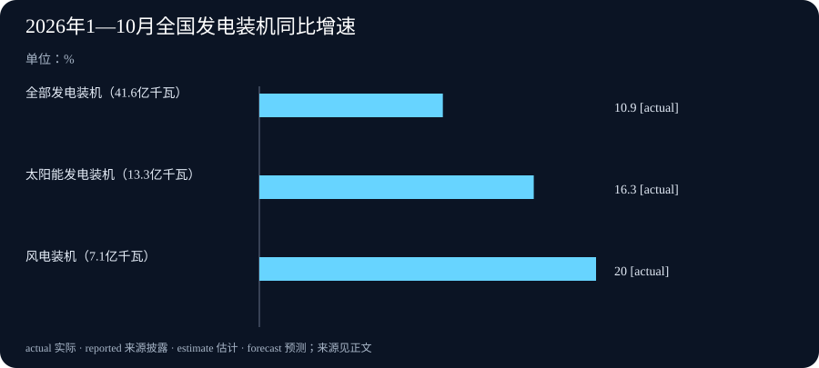

# Energy Intelligence · 读懂能源变化 — 2026-11-26 能源日报

日期：2026-11-26（周四，Asia/Shanghai）。本期覆盖两份省级 2027 年度电力市场文件、国家能源局 1—10 月电力统计、江苏电网侧独立储能清单、宁夏 750 千伏通道投运、浙江绿电直连项目落地、"一带一路"能源合作伙伴关系理事会成立、广东大湾区能源条款与海外储能交付八条线。全部来源均于本日早间实际访问并核对原文；披露日与文件日、事件日不同的，正文同时标注（山东鲁发改能源〔2026〕868 号与《2027 年浙江省电力市场化交易方案》均印发于 11 月 24 日、行业媒体 11 月 25 日转载；江苏清单所据通知文件日期为 11 月 10 日、11 月 25 日公开；广东粤府办〔2026〕13 号印发于 11 月 23 日、11 月 25 日转载；宁夏西岭 750 千伏工程于 11 月 24 日 23 时 53 分投运、11 月 25 日报道；电力统计 11 月 25 日发布、统计口径为 1—10 月；浙江绿电直连稿由国家能源局 11 月 24 日发布、正文所述调研为"近日"，该稿已超出本期"当日或前一日"的一手来源窗口，因此只在正文作背景引用、不计入 `data.sources`；计入来源清单的 8 条均为 11 月 25 日发布）。

## Today's Thesis 今日论点

41.6 亿千瓦与 2406 小时被写进同一份文件，这就是本期的主线。国家能源局 11 月 25 日发布 1—10 月份全国电力统计数据：截至 10 月底全国累计发电装机 41.6 亿千瓦、同比增长 10.9%，其中太阳能发电装机 13.3 亿千瓦增长 16.3%、风电装机 7.1 亿千瓦增长 20.0%，而 1—10 月全国发电设备累计平均利用小时 2406 小时、比上年同期降低 214 小时（[统计数据](https://www.nea.gov.cn/20261125/155af4f250be4ce99ae523fff16801f0/c.html)）。装机在涨，每台机组平均可卖出的时间在缩，"多装"与"多卖"之间的联系正在变松。同日披露的两份 2027 年度文件给出的对策是换计价对象：山东以鲁发改能源〔2026〕868 号建立发电侧可靠容量补偿机制，按"全年系统顶峰时段能够持续稳定供电的容量"核定，把符合条件的电网侧独立新型储能与煤电、气电放进同一个补偿池，补偿费用纳入系统运行费由全体工商业用户分摊（[山东通知](https://power.in-en.com/html/power-2481485.shtml)）；浙江把中长期交易电量占比写成不低于 90%、煤电浮动不超过 20%，并对现货实施二级限价（[浙江方案](https://power.in-en.com/html/power-2481496.shtml)）。再叠加江苏 24 个电网侧独立储能项目须在 2027 年 10 月底前建成投运、宁夏西岭 750 千伏工程 11 月 24 日投运，本期的判断是：2027 年的竞争项不再是装机容量，而是顶峰时段的可用性——它正同时进入补偿规则、交易结构、并网工期与物理通道四个科目。

## Executive Summary 执行摘要

- 国家能源局 11 月 25 日发布 1—10 月份全国电力统计数据：截至 10 月底全国累计发电装机 41.6 亿千瓦、同比增长 10.9%，太阳能 13.3 亿千瓦、增长 16.3%，风电 7.1 亿千瓦、增长 20.0%；1—10 月全国发电设备累计平均利用小时 2406 小时、比上年同期降低 214 小时（[统计数据](https://www.nea.gov.cn/20261125/155af4f250be4ce99ae523fff16801f0/c.html)）。
- 11 月 24 日，山东省发展改革委、省能源局、国家能源局山东监管办公室发布《关于做好 2027 年全省电力市场建设有关工作的通知》（鲁发改能源〔2026〕868 号）：建立发电侧可靠容量补偿机制，按全年系统顶峰时段可持续稳定供电容量核定，补偿范围含自主参与市场的煤电、气电与符合条件的电网侧独立新型储能，费用纳入系统运行费由全体工商业用户分摊；抽水蓄能全电量入市，独立储能完善 SOC 管理，虚拟电厂明确填谷收益分摊机制（[山东通知](https://power.in-en.com/html/power-2481485.shtml)）。
- 同日，浙江省发展改革委、省能源局、浙江能源监管办印发《2027 年浙江省电力市场化交易方案》：交易规模按全省工商业用户年度总用电量确定，原则上中长期交易电量占比不低于 90%、其余电量通过现货市场交易，煤电交易价格上下浮动范围不超过 20%，现货在出清价格上下限基础上实施二级限价机制（[浙江方案](https://power.in-en.com/html/power-2481496.shtml)）。
- 11 月 25 日公开的江苏省发展改革委《加快推进促投资百日攻坚行动电网侧独立新型储能项目建设》通知（文件日期 11 月 10 日）列出 24 个电网侧独立储能项目，合计规模超 2.725 吉瓦/10.1 吉瓦时、平均储能时长 4 小时，单个项目多为 100MW/400MWh、最大 250MW/1GWh，要求 2027 年 10 月底前建成投运（[江苏清单](https://chuneng.in-en.com/html/chunengy-60289.shtml)）。
- 11 月 24 日 23 时 53 分，宁夏西岭 750 千伏输变电工程随 1、2、3 号主变压器进入 72 小时试运行而并网投产；工程总投资超 10 亿元、建设周期两年（线路 2024 年 11 月 25 日开工），采用 HGIS 配电装置与一个半断路器接线，服务"沙戈荒"大型新能源基地送出（[西岭工程](https://www.ne21.com/news/show-234586.html)）。
- 国家能源局 11 月 24 日消息，浙江能源监管办会同华东能源监管局调研杭州永杰铝业 72MW 绿电直连项目：项目 2026 年 8 月获批，为浙江省首个、华东首个出口外向型绿电直连项目，总投资 3.28 亿元，新建 72MW 光伏电站并配套 30MW/75MWh 储能，计划 2026 年 12 月 28 日投产，投用后预计每年为企业节省碳关税支出约 900 万元、节约用电成本约 300 万元（[绿电直连](https://www.nea.gov.cn/20261124/f74062a55cea49c48346e16666cc9529/c.html)）。
- 11 月 25 日下午，"一带一路"能源合作伙伴关系理事会正式成立并在青岛召开第一次会议，审议通过理事会组建方案、第四届"一带一路"能源部长会议方案与伙伴关系 2027 年度工作计划，一致同意通过《部长联合声明》"1+6"系列成果文件，合作方向含提升终端电气化率与加强跨境电网互联（[理事会](https://www.nea.gov.cn/20261125/a0788a1a3a164e2cbf68b8178b734699/c.html)）；同一天，广东省政府办公厅《推进粤港澳大湾区世界级绿色低碳产业集群建设实施方案》（粤府办〔2026〕13 号，11 月 23 日印发）提出推进西北、西南等地区送电广东直流工程（[广东方案](https://www.ne21.com/news/show-234589.html)），晶科储能则披露其在西班牙两个合计 90 兆瓦时的储能项目（[Jinko ESS](https://www.ess-news.com/2026-11-25/jinko-ess-supports-the-next-phase-of-battery-storage-development-in-spain/)）。

## Policy Daily 政策动态

**山东：把"顶峰能撑多久"写成容量货币**
11 月 24 日，山东省发展和改革委员会、山东省能源局、国家能源局山东监管办公室联合发布《关于做好 2027 年全省电力市场建设有关工作的通知》（鲁发改能源〔2026〕868 号，行业媒体 11 月 25 日转载）。文件最具分量的一句是完善发电主体参与市场机制、建立发电侧可靠容量补偿机制：发电侧统一按照机组可靠容量给予容量补偿，保障各类经营主体公平享有容量收益；机组可靠容量按照发电主体在全年系统顶峰时段能够持续稳定供电的容量核定，补偿范围包括自主参与山东电力市场的煤电、气电和符合条件的电网侧独立新型储能等具备可靠容量的机组；获得其他保障的容量不重复补偿，政府定价机组不予补偿。补偿标准以弥补市场边际机组在电能量、辅助服务市场无法回收的固定成本为基础，统筹电力供需关系、用户承受能力与电力市场建设进展合理确定，补偿费用纳入系统运行费，由全体工商业用户分摊。文件同时明确火电机组运行成本补偿机制：在新能源大发时段，机组 30%（含）额定负荷以内因保障电力系统安全运行需要产生的电能量成本纳入补偿范围，供热机组因供热多发电量不予补偿，配建储热设施增加的顶峰发电能力不予容量补偿和运行补偿。调节资源侧的表述同样具体：抽水蓄能电站全电量参与电力市场，存量电站按抽水用电成本与发电收益持平对应的抽水发电成本价差参与现货市场出清；推动独立储能实时市场根据新能源出力波动情况优化充放电计划，完善独立储能充放电、调峰与电能量市场衔接以及独立储能 SOC 管理机制；推动明确虚拟电厂填谷收益分摊机制（[山东通知](https://power.in-en.com/html/power-2481485.shtml)）。与昨日报道的《山东省新型能源体系建设"十五五"规划》对照，两份文件构成"目标—年度工具"的关系：规划写下 2030 年 3000 万千瓦新型储能、400 万千瓦虚拟电厂可调规模与 7500 万千瓦分布式接入能力，868 号文则规定 2027 年这些资源靠哪个科目收到钱。

**浙江：90% 中长期与二级限价，把现货留给边际**
11 月 24 日，浙江省发展改革委、省能源局、浙江能源监管办印发《2027 年浙江省电力市场化交易方案》（行业媒体 11 月 25 日转载）。方案规定，2027 年电力市场化交易规模根据全省工商业用户年度总用电量确定，其中原则上中长期交易电量占比不低于 90%，其余电量通过现货市场交易。价格机制上，交易价格按参与方式分为直接交易价格和代理购电价格：直接交易价格由交易双方通过中长期、现货市场形成，中长期市场执行"基准价+上下浮动"的市场价格机制，煤电交易价格上下浮动范围不超过 20%；现货市场在出清价格上限、下限的基础上实施二级限价机制；代理购电价格按《省发展改革委 省能源局关于完善电网企业代理购电价格形成机制的通知》（浙发改能源〔2025〕108 号）执行（[浙江方案](https://power.in-en.com/html/power-2481496.shtml)）。这份方案的信息量在结构而非数字：90% 的电价在年度与月度中长期合同里形成，现货只承担剩余不到 10% 电量的价格发现，且极端价格再被二级限价封顶。对以价差为核心假设的独立储能与虚拟电厂项目，这类设计意味着 2027 年浙江的现货收益上限可预期但不高，测算必须把容量、辅助服务与需求响应单列。

**"一带一路"能源合作伙伴关系理事会成立：从搭框架到建机制**
11 月 25 日下午，"一带一路"能源合作伙伴关系理事会正式成立，第一次会议在青岛召开，国家能源局局长、理事会主席王宏志出席会议并致辞，伙伴关系成员国能源部长、驻华大使等高级别代表出席发言。会议审议通过理事会组建方案、第四届"一带一路"能源部长会议方案与伙伴关系 2027 年度工作计划，并一致同意通过《部长联合声明》"1+6"系列成果文件。各方呼吁深化在保障能源安全、推动能源转型、提升终端电气化率、加强跨境电网互联、促进人工智能与能源双向赋能、完善新型能源治理体系、创新金融工具等方面的合作；王宏志表示第一次理事会的召开标志着伙伴关系从"搭框架"进入"建机制、抓落实"的新阶段（[理事会](https://www.nea.gov.cn/20261125/a0788a1a3a164e2cbf68b8178b734699/c.html)）。对能源装备与电力运营主体，这份文件的意义在于 2027 年度工作计划与"1+6"成果把跨境电网互联、终端电气化写成机制性合作方向，为海外项目提供了可检索的合作接口，而不是零散的个案签约。

**广东：产业集群方案把区外绿电与直流通道并列**
11 月 23 日，广东省人民政府办公厅印发《广东省推进粤港澳大湾区世界级绿色低碳产业集群建设实施方案》（粤府办〔2026〕13 号，行业媒体 11 月 25 日转载）。能源基础保障部分提出：加快建设粤港澳大湾区清洁能源供应保障体系，对项目审批、用海用地、资金投入依法依规给予支持；支持新一代煤电规划建设，推动生物质掺烧、绿氨掺烧、CCUS 等技术在煤电低碳化改造中的应用；统筹考虑粤港澳三地碳达峰碳中和目标，支持通过电网、管网、路网等方式推进更高比例、更大规模、更广范围的区外清洁能源供应，优化区域碳排放考核核算；支持粤港澳大湾区能源企业参与区外新能源建设，推进西北、西南等地区送电广东直流工程（[广东方案](https://www.ne21.com/news/show-234589.html)）。这份文件的行业含义是尺度：制造业集群的碳约束被转写成对区外电力与外送通道的投资需求，与本期浙江单个园区的绿电直连逻辑相同，只是从企业账本变成省级工程清单。

## Market Daily 市场动态

- **数据：装机 +10.9%，利用小时 -214 小时。** 国家能源局 11 月 25 日发布的 1—10 月份全国电力统计数据显示，截至 10 月底全国累计发电装机 41.6 亿千瓦、同比增长 10.9%，其中太阳能发电装机 13.3 亿千瓦、同比增长 16.3%，风电装机 7.1 亿千瓦、同比增长 20.0%；1—10 月份全国发电设备累计平均利用 2406 小时，比上年同期降低 214 小时。按公布增速折算，1—10 月风电与光伏合计净增约 3.0 亿千瓦，约占全国净增的四分之三（折算口径，官方未披露分类型同期净增绝对量）；风光合计 20.4 亿千瓦、约占全国装机的 49.0%（按公布数字计算）。边际增量几乎由风光贡献，而全部机组的平均发电小时在下降，这是本期所有容量与价格讨论的共同背景（[统计数据](https://www.nea.gov.cn/20261125/155af4f250be4ce99ae523fff16801f0/c.html)）。
- **清单：江苏把 24 个电网侧储能的工期压到 2027 年 10 月。** 江苏省发展改革委 11 月 10 日发布《加快推进促投资百日攻坚行动电网侧独立新型储能项目建设》的通知，梳理可于 2026 年年底前开工的电网侧储能项目 24 个，合计规模超 2.725 吉瓦/10.1 吉瓦时，平均储能时长 4 小时；单个项目规模多数在 100MW/400MWh 左右，最大为 250MW/1GWh。文件明确本批项目要在 2027 年 10 月底前建成投运，要求省电力公司在接网工程、计量点设置、并网协议、停电计划、调试运行、电费结算等环节做好指导与服务，项目单位为倒送电、质监验收、并网调试等关键流程预留时间（[江苏清单](https://chuneng.in-en.com/html/chunengy-60289.shtml)）。当"平均 4 小时"成为省级清单的统计口径，长时不再是宣传语而是并网的先决条件。
- **通道：宁夏 750 千伏双层双环网补上沙戈荒送出点。** 11 月 24 日 23 时 53 分，随着网调通知 1、2、3 号主变压器进入 72 小时试运行，西岭 750 千伏输变电工程正式并网投产。该工程是宁夏"沙戈荒"大型新能源基地重点配套枢纽工程，2024 年 11 月 25 日线路开工、建设周期两年、总投资超 10 亿元，采用国内成熟的高可靠性 HGIS 配电装置与一个半断路器接线；投运后进一步完善宁夏 750 千伏双层立体双环网架，补齐沙戈荒新能源送出网架短板（[西岭工程](https://www.ne21.com/news/show-234586.html)）。基地项目并网时序与骨干通道投运节点之间的匹配，正成为西北地区消纳结论的关键变量。
- **场景（背景引用）：浙江首个绿电直连项目 12 月 28 日投产。** 浙江能源监管办会同华东能源监管局近日赴杭州永杰铝业 72MW 绿电直连项目开展现场调研。项目 2026 年 8 月正式获批，是浙江省首个、也是华东首个出口外向型绿电直连项目，由民营企业杭州凌瀚新能源开发有限公司全额投资，总投资 3.28 亿元，规划新建 72MW 光伏电站并配套 30MW/75MWh 储能向厂区供电，目前已完成升压站主体结构封顶，计划 2026 年 12 月 28 日投产；建成后每年可向企业稳定输送可溯源绿电，预计每年节省碳关税支出约 900 万元、节约用电成本约 300 万元（[绿电直连](https://www.nea.gov.cn/20261124/f74062a55cea49c48346e16666cc9529/c.html)）。这是把碳价写进项目财务模型的具体样本：储能在这里不是套利资产，而是绿电可溯源与供电连续性的组成部分。需说明的是，该稿由国家能源局 11 月 24 日发布，已超出本期当日或前一日的一手来源窗口，故只作背景引用，不计入 `data.sources`。
- **出海：晶科储能在西班牙交付 90 兆瓦时。** Jinko ESS 11 月 25 日披露其在西班牙的两个电池储能项目，合计容量 90 兆瓦时：位于 Jerez de los Caballeros 附近的 75 兆瓦时项目正在交付，位于 Cartagena 的 15 兆瓦时项目处于生产阶段；两个项目均采用其 5 兆瓦时电池储能容器，共部署 18 台。公司把打法概括为三点——本地技术与商务团队、依托晶科光伏业务积累的既有关系、以及交付速度，并强调西班牙光伏与风电的持续增长正在抬高对"能快速响应电网条件变化"的储能容量的需求（[Jinko ESS](https://www.ess-news.com/2026-11-25/jinko-ess-supports-the-next-phase-of-battery-storage-development-in-spain/)）。

## Competitor Watch 竞对动态

本期跟踪的三家充电主体——特来电（特锐德，300001）、星星充电（万帮数字能源）、云快充——在 11 月 25 日至 26 日早间均未检索到可核实的一手动态，按静默日处理，不计入来源。核查过程与结论：特锐德公告检索显示，11 月 23 日《关于公司预中标国网项目的提示性公告》为最新一条，其后是 11 月 20 日的第六届董事会第十七次会议决议与 2024 年员工持股计划第一个锁定期届满解锁公告，11 月 24 日至 26 日无新增公告，即 11 月 23 日披露的"预中标国家电网 2026 年华东区域第二次联合采购 10kV 变压器、10kV 柱上变压器台成套设备框架协议"约 2.39 亿元尚未转为正式中标确认，最终以公司公告为准；星星充电与云快充在这两日均未见公开的主体动态。有三条可替代信号值得记录：其一，山东 868 号文把符合条件的电网侧独立新型储能与煤电、气电并列纳入可靠容量补偿，充电运营商旗下的储能资产若满足接入与市场注册条件，其收益结构将从服务费与价差扩展到容量科目；其二，江苏 24 个项目 2027 年 10 月底前的统一工期，会把设备与 EPC 的交付排队压力集中到明年三季度之前，运营商的扩表节奏受上游产能约束；其三，广东提出推进西北、西南等地区送电广东直流工程，湾区充电网络与虚拟电厂的电力来源将更依赖区外通道，与"车网互动"本地调节形成互补关系。需要说明的是，中国充电联盟 10 月公共充电设施运营商月充电电量 TOP15 榜单发布于 11 月 23 日、本期仅作背景引用，不作为当日来源。

## Signal Dashboard 信号看板

- 计价口径切换：山东把容量补偿的核定基准从铭牌功率改为"全年系统顶峰时段能够持续稳定供电的容量"，方向利好长时与高可用率资产，方向性偏多电网侧独立储能。
- 成本显性化：补偿费用纳入系统运行费、由全体工商业用户分摊，意味着用户侧电价中将出现可拆分的容量科目，售电公司与大用户的合同结构需要重谈。
- 现货空间收窄：浙江 90% 中长期占比加煤电浮动不超过 20%、现货二级限价，压缩了现货极端价差的可期待区间，纯套利型储能项目的内部收益率假设需要下修。
- 工期集中：江苏 24 个项目统一要求 2027 年 10 月底前建成投运，接入评审、并网检测与调试资源将在明年三季度形成排队，EPC 与检测服务环节的议价能力上升。
- 通道与基地同期收口：宁夏西岭 750 千伏投运补齐沙戈荒送出短板，"装机已定、通道未至"的项目风险在西北被部分解除，但消纳责任从网架转向调度与市场主体。
- 需求侧的新账本：浙江绿电直连以年省约 900 万元碳关税与约 300 万元电费为收益，出口制造业的能源投资第一次以碳价折现，配储 30MW/75MWh 成为可溯源电价的成本项。
- 结构性背离：装机同比 +10.9%、利用小时同比 -214 小时，发电侧的收入增长越来越依赖价格与容量科目而非电量，行业研究的分母正在从"千瓦时"转向"千瓦×可用率"。
- 外部市场同频：晶科储能把"本地服务与长期运营"写成主要卖点，与山东"可靠容量"的规则语言指向同一件事——可交付与可验证正在取代装机数字成为竞争项。

## Deep Insight 深度洞察

**顶峰时段成为新的计价单位**

把 11 月 25 日的三份材料并排放在一起，可以看到同一种语法。统计数据讲的是分母：全国累计发电装机 41.6 亿千瓦、同比增长 10.9%，而 1—10 月全国发电设备累计平均利用小时 2406 小时、比上年同期少 214 小时。这句话的实际含义是，全国机组平均"能卖出去的小时"在缩短；缩短并不均匀，它集中在边际成本最低的风光上，也集中在缺少调节手段的时段。当发多少小时不再由装多少千瓦决定，收入就必须由另一套指标来分配。山东与浙江同日披露的两份 2027 年度文件，做的正是这件事。

山东的路径是给可用性定价。868 号文把容量补偿的核定基准写成"全年系统顶峰时段能够持续稳定供电的容量"，这是一个可以被核查的物理量：不是铭牌功率，不是年利用小时，而是在系统最需要的那几个小时里能持续出力多少。煤电、气电与符合条件的电网侧独立新型储能被放进同一个补偿池，同时划出两条排除线——获得其他保障的容量不重复补偿、政府定价机组不予补偿。补偿标准锚定"市场边际机组在电能量与辅助服务市场无法回收的固定成本"，费用进系统运行费、由全体工商业用户分摊。这套写法把储能从"套价差"的单一收益模型里拉出来一半：在山东，一个 4 小时项目的价值不再只取决于现货价差能否拉开，还取决于它能否被核定为顶峰时段的可靠容量。文件同时保留火电 30% 额定负荷以内的保供运行成本补偿、抽水蓄能全电量入市、独立储能 SOC 管理与虚拟电厂填谷收益分摊机制，等于把深度调峰、顶峰出力与充放电安排三段都写进了结算口径，调节资源第一次以"能力科目"而非"补贴名目"出现。

浙江走的是另一条路：先限定现货的作用范围。中长期电量占比不低于 90%、煤电交易价格上下浮动不超过 20%、现货实施二级限价，三条合起来意味着 2027 年浙江的电价主战场在年度与月度中长期合同里，现货只承担剩余不到 10% 电量的价格发现，且极端价格再被封顶。两省构成一组有用的对照：一个从收益侧新增容量科目，一个从收益侧收窄波动区间；前者抬高储能项目的确定性收益占比，后者压低价差收益的可期待上限。对跨省投资的主体，真正的风险不是政策方向，而是同一资产在两个省必须用两套财务模型，且模型之间的差异无法通过对冲消除。

物理侧的约束在这两天同样清楚。江苏把 24 个电网侧独立储能项目的建成投运时点统一到 2027 年 10 月底，规模超 2.725 吉瓦/10.1 吉瓦时、平均 4 小时、多数 100MW/400MWh、最大 250MW/1GWh，并要求省电力公司在接网工程、计量点设置、并网协议、停电计划、调试运行与电费结算环节提供服务；宁夏西岭 750 千伏输变电工程 11 月 24 日 23 时 53 分随三台主变进入 72 小时试运行而并网投产，总投资超 10 亿元，直接服务沙戈荒基地送出。工期与通道同时收紧，说明 2027 年的瓶颈正从"能否立项"转向"能否按时并网并被调度认可"——这也是利用小时下降的另一面：网架与调节未到位时，新增装机的边际发电小时被优先压缩。

外部维度补上同一块拼图。"一带一路"能源合作伙伴关系理事会 11 月 25 日在青岛成立，审议通过理事会组建方案、第四届部长会议方案与伙伴关系 2027 年度工作计划，一致同意通过《部长联合声明》"1+6"系列成果文件，合作方向明确写入提升终端电气化率与加强跨境电网互联；同一天，晶科储能披露在西班牙两个合计 90 兆瓦时的项目，75 兆瓦时在交付、15 兆瓦时在生产，全部采用 5 兆瓦时容器共 18 台，并把"从项目交付到长期运营的本地服务能力"作为主要卖点。出海叙事与国内规则在同一处合流：卖出去的不再只是设备，而是被验证过的可用性。浙江永杰铝业的案例则把这条逻辑接到需求侧——72MW 光伏配 30MW/75MWh 储能以可溯源绿电应对欧盟碳边境调节机制，年省碳关税约 900 万元、电费约 300 万元，能源投资第一次以碳价折现的形式出现在单个工厂的账本上。

风险与未定项需要如实写下。第一，山东尚未公布可靠容量的核定方法与补偿单价：储能按多大折算系数计入、分摊总额在用户侧如何体现，将决定这套机制内部的收益率排序，也决定"符合条件"四字的实际边界。第二，二级限价与 90% 中长期占比会压低现货极端价差，若容量或辅助服务科目未能同步落地，独立储能项目在浙江可能两头落空。第三，工期集中意味着并网检测、接入评审与调试资源被压进同一窗口，交付排队本身就是成本，这一课在海外厂商的财报里已经出现过。第四，跨境合作机制化不等于订单落地，2027 年度工作计划能否转成项目清单仍待观察。结论是可操作的：跟踪口径应从"某省新增多少装机"切换为三张表——顶峰可靠容量及其折算规则、容量补偿的单价与分摊规模、现货限价与中长期比例对价差空间的压缩程度。

## Tomorrow Watch 明日关注

- 山东 868 号文配套的可靠容量核定方法与补偿单价是否在年度结算细则中公布，独立储能的折算系数、"符合条件"的认定口径与分摊额度如何体现。
- 浙江《2027 年浙江电力现货市场运行方案》与本次交易方案的衔接：二级限价的具体档位、触发条件与结算处理方式是否公开。
- 江苏 24 个电网侧独立储能项目的分设区市名单、开工与并网时序，以及 2027 年 10 月底工期约束下接入评审与调试资源的排队情况。
- 国家能源局 11 月电力工业统计数据（通常月底发布）能否给出火电、核电、常规水电分项与 1—11 月平均利用小时，验证装机与利用率剪刀差是否继续扩大。
- 第四届"一带一路"能源部长会议的时间地点与《部长联合声明》"1+6"成果文件文本，伙伴关系 2027 年度工作计划中跨境电网互联与终端电气化的项目化安排。
- 广东推进西北、西南送电广东直流工程的年度进展与受端配套安排，以及湾区能源企业参与区外新能源建设的具体项目披露。
- 特锐德 11 月 23 日预中标约 2.39 亿元国网项目能否转为正式中标；特来电、星星充电、云快充在 11 月 26 日至 27 日是否恢复可核实的公开动态。

## One Chart 一图看懂

数据取自国家能源局 11 月 25 日发布的《国家能源局发布 2026 年 1—10 月份全国电力统计数据》，单位统一为百分比：截至 10 月底全国累计发电装机容量同比增长 10.9%，其中太阳能发电装机容量同比增长 16.3%、风电装机容量同比增长 20.0%。三根柱子的间距本身就是结构变化：风电增速领先光伏、两者都领先总量，说明边际增量主要由风光贡献——按公布增速折算，风光两项 1—10 月合计净增约 3.0 亿千瓦，约占全国净增的四分之三，合计 20.4 亿千瓦、占全国装机的 49.0%。同一份统计里还有一项方向相反的指标：1—10 月份全国发电设备累计平均利用 2406 小时，比上年同期降低 214 小时。装机增速为正、利用小时增速为负，正是本期两份 2027 年度文件试图处理的问题——把收入的一部分从"发了多少千瓦时"转移到"顶峰时段能提供多少可用千瓦"。原始表述见[国家能源局统计数据](https://www.nea.gov.cn/20261125/155af4f250be4ce99ae523fff16801f0/c.html)。

## Quote of the Day 今日引言

> "Spain is an exciting and important market for energy storage, and we are very pleased to support this portfolio across the two projects. Through our established local service capabilities, we provide hands-on support from project delivery to long-term operation, ensuring sustainable performance and returns on investment."

> — Roberto Murgioni, General Manager of Jinko ESS Europe（晶科储能欧洲总经理）

中文译文：西班牙是一个充满活力且重要的储能市场，我们很高兴为这两个项目组成的组合提供支持；依托已经建立起来的本地服务能力，我们从项目交付一直到长期运营提供现场支持，确保持续的性能表现与投资回报。

出处：Energy-Storage.news（ESS News）2026 年 11 月 25 日刊发的《Jinko ESS Supports the Next Phase of Battery Storage Development in Spain》，属企业提供的新闻稿栏目（Press releases），文中说明其在西班牙两个项目合计 90 兆瓦时、采用 18 台 5 兆瓦时储能容器（[报道原文](https://www.ess-news.com/2026-11-25/jinko-ess-supports-the-next-phase-of-battery-storage-development-in-spain/)）。语境：这句话的关键词不是价格而是本地服务。在同一天，山东把"全年系统顶峰时段能够持续稳定供电的容量"写成补偿基准、江苏把 24 个储能项目的工期压到 2027 年 10 月底——国内在规则侧给可用性定价，中国储能厂商在海外市场把卖点从容器参数转向"从交付到长期运营"的可运维承诺。可用性同时成为计价科目与销售话术，这不可能是巧合，而是同一个过剩周期的两面。

## Action Items 行动项

1. **可靠容量折算表** 建立山东煤电、气电与电网侧独立储能可靠容量核定口径的跟踪表，把"顶峰时段可持续稳定供电小时数"作为项目评审与投标报价的必填字段
2. **价差敏感度重算** 以浙江中长期电量占比不低于 90%、煤电浮动不超过 20%、现货二级限价为边界，重做浙江侧储能与虚拟电厂项目的收益敏感性，把容量与辅助服务科目单列
3. **分摊成本传导** 跟踪容量补偿费用纳入系统运行费后在工商业电费中的体现方式，为售电公司报价与大用户多年期合同提供成本口径
4. **工期排队评估** 按设区市汇总江苏 24 个项目的接入、倒送电与并网调试窗口，判断 2027 年三季度前的检测与验收资源是否构成关键路径
5. **通道匹配核查** 把沙戈荒等基地的并网时序与 750 千伏及以上通道投运节点做成匹配表，识别"装机已定、通道未至"的高风险项目
6. **碳价折现建模** 参照浙江 72MW 绿电直连配套 30MW/75MWh 储能节省碳关税约 900 万元的样本，为出口制造客户建立绿电直连与储能配置的碳价折现模型
7. **出海尽调补项** 对海外储能投标增加本地服务网络、备件库存与运维响应时长三项尽调，对照晶科储能西班牙 90 兆瓦时项目的表述口径评估自身交付凭证
