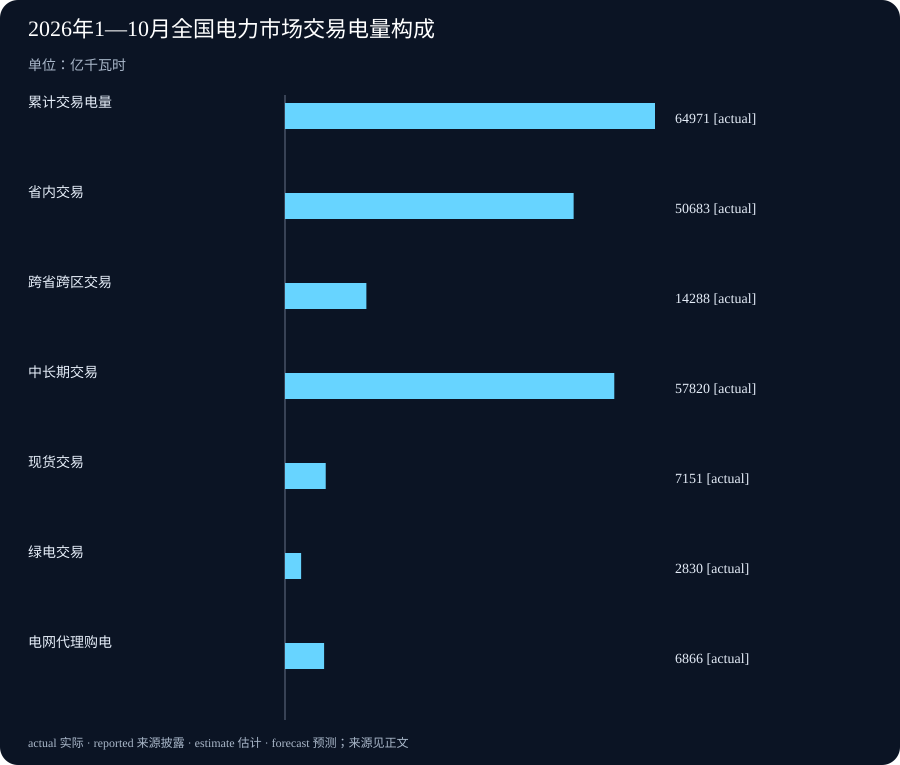

# Energy Intelligence · 读懂能源变化 — 2026-11-27 能源日报

日期：2026-11-27（周五，Asia/Shanghai）。本期覆盖国家能源局 1—10 月全国电力市场交易电量、江苏 2027 年新能源增量项目机制电价竞价、四川工商业分时电价机制征求意见、国内成品油价格下调、第四届“一带一路”能源部长会议，以及意大利、印度、西班牙、爱沙尼亚四条海外储能线，合计九条当日或前一日发布的一手来源（政策类四条、市场类五条）。全部来源均于本日早间实际访问并核对原文，披露日与文件日、事件日不同的，正文同时标注：江苏竞价通知（苏发改价格发〔2026〕1119 号）落款 11 月 24 日、省发展改革委 11 月 25 日印发、财经端 11 月 26 日转载文件全文；四川分时电价征求意见稿由四川省发展改革委 11 月 25 日公开发布、四川在线 11 月 26 日刊发逐条解读；成品油调价自 11 月 26 日 24 时起执行、国家发展改革委 11 月 26 日发布。《山东省发电侧可靠容量补偿实施细则（征求意见稿）》二次征求意见公告发布于 11 月 23 日、行业媒体 11 月 25 日转载，已超出本期“当日或前一日”的一手来源窗口，因此只在正文作背景引用、不计入 data.sources。

## Today's Thesis 今日论点

本期主线是“把一度电拆开计价”。国家能源局 11 月 26 日发布 2026 年 1—10 月全国电力市场交易电量统计：累计完成交易电量 64971 亿千瓦时、同比增长 18.3%，其中省内 50683 亿千瓦时、增长 21.7%，跨省跨区 14288 亿千瓦时、仅增长 7.7%；单看 10 月，全国交易电量 6435 亿千瓦时、同比增长 14.1%，但跨省跨区只有 1251 亿千瓦时、同比增长 0.3%（[交易电量统计](http://www.nea.gov.cn/20261126/e31e25a7929e472aaf8ac7b83eec2d78/c.html)）。市场化确实在放量，可放量的主要是省内市场——省内电量增速是省间的近三倍，10 月省间几乎停滞。同期落地与征求意见的三份省级文件，把“电量之外”的科目逐项标价：江苏启动 2027 年新能源增量项目机制电价竞价，机制电量总规模 130 亿千瓦时，两类报价上限同为 0.391 元/千瓦时，海上风电下限 0.3 元/千瓦时、其他风电和光伏下限由上一批次的 0.25 元下调至 0.2 元/千瓦时（[江苏竞价通知](https://finance.sina.com.cn/roll/2026-11-26/doc-inkaaaxc1450029.shtml)）；四川拟自 2027 年 1 月 1 日起完善工商业分时电价，高峰上浮 60%、低谷下浮 60% 的比例不变，但输配电价、线损与政府性基金退出浮动基数，午间新增 13:00—15:00 低谷段，全年尖峰时段原则上不超过 260 小时（[四川征求意见](https://sichuan.scol.com.cn/ggxw/202611/83363931.html)）；山东的可靠容量补偿实施细则二次征求意见把统一补偿标准暂定为 343 元/千瓦·年（背景引用，[山东细则](https://chuneng.in-en.com/html/chunengy-60306.shtml)）。海外的同一道题写在合同里：Statkraft 与 Zelestra 就意大利 175MW/700MWh 项目签署 8 年物理调度权协议（tolling），L&T 取得印度古吉拉特 300MW/900MWh 订单，而马德里的行业圆桌把“可融资性”列为西班牙 2030 年 6 至 10 吉瓦储能目标的主要障碍。本期的判断是：2027 年的竞争项不再是装机容量或电量增速，而是收入结构能否被计价、被核验、被写进可执行合同——在国内表现为计价科目的拆分，在海外表现为合同结构的重排。

## Executive Summary 执行摘要

- 国家能源局 11 月 26 日发布：2026 年 10 月全国各电力交易机构完成交易电量 6435 亿千瓦时、同比增长 14.1%，其中省内 5184 亿千瓦时增长 18.5%、跨省跨区 1251 亿千瓦时增长 0.3%，中长期 5631 亿千瓦时、现货 804 亿千瓦时、绿电 339 亿千瓦时、电网企业市场化代理购电 578 亿千瓦时；1—10 月累计 64971 亿千瓦时、同比增长 18.3%（[统计原文](http://www.nea.gov.cn/20261126/e31e25a7929e472aaf8ac7b83eec2d78/c.html)）。
- 江苏省发展改革委印发苏发改价格发〔2026〕1119 号，启动 2027 年新能源增量项目机制电价竞价：范围覆盖 2025 年 6 月 1 日至 2027 年 12 月 31 日全容量并网且未纳入过机制电价的项目，机制电量总规模 130 亿千瓦时（海上风电 5 亿、其他风电和光伏 125 亿），执行期限海上风电 15 年、其他项目 10 年，其他风电和光伏报价下限降至 0.2 元/千瓦时（[通知全文](https://finance.sina.com.cn/roll/2026-11-26/doc-inkaaaxc1450029.shtml)）。
- 四川省发展改革委就《关于完善我省工商业分时电价机制的通知（征求意见稿）》公开征求意见，拟自 2027 年 1 月 1 日起执行：仅上网电价（含三项价差费用）与系统运行费用执行分时浮动，输配电价、线损、政府性基金及附加不再浮动；非夏季月份低谷调整为 2:00—8:00 与 13:00—15:00，全年尖峰原则上不超过 260 小时，50 千伏安及以上代理购电工商业用户强制执行，充电设施分类纳入（[四川在线解读](https://sichuan.scol.com.cn/ggxw/202611/83363931.html)）。
- 国家发展改革委宣布，自 11 月 26 日 24 时起国内汽、柴油（标准品）价格每吨分别下调 440 元、425 元；上一轮调整为 11 月 12 日，本次调价前 10 个工作日平均价格低于上次调价前水平（[发改委公告](https://www.ndrc.gov.cn/xwdt/xwfb/202611/t20261126_1409082.html)）。
- 第四届“一带一路”能源部长会议开幕式及主论坛 11 月 26 日上午在青岛举行，主题“共享创新成果 共促能源转型 共筑安全未来”，会议期间举行“一带一路”能源合作伙伴关系理事会成立仪式、智库工作组与“人工智能+能源”工作组成立仪式，并发布“创新赋能”最佳实践、《发展中国家能源绿色低碳转型与安全韧性蓝皮书》和部长联合声明（[会议报道](https://obor.nea.gov.cn/detail2/23382.html)）。
- 海外储能进入“合同定价”阶段：Statkraft 与 Zelestra 就意大利中部 175MW/700MWh（4 小时）项目签订 8 年物理 tolling 协议、计划 2028 年投运，Statkraft 已在欧洲九国签约逾 4 吉瓦储能优化容量；Larsen & Toubro 依交易所公告取得印度古吉拉特 Khavda 300MW/900MWh（3 小时）订单，未披露客户与合同金额；爱沙尼亚 Lihula 项目以 55MW/250MWh 配 77.5MW 光伏电站完工，为波罗的海地区最大单体储能（[意大利](https://www.ess-news.com/2026-11-26/zelestra-statkraft-sign-700-mwh-battery-tolling-deal-in-italy/)、[印度](https://www.ess-news.com/2026-11-26/indian-engineering-firm-wins-900-mwh-battery-order/)、[爱沙尼亚](https://www.ess-news.com/2026-11-26/estonian-250-mwh-bess-added-to-existing-solar-plant-now-completed/)）。
- 马德里 Genera 2026 圆桌估计西班牙 2030 年储能装机在 6 至 10 吉瓦之间（约合近 40 吉瓦时），并指出 2026 年储能收益中二次调频约占 60%、套利约 40%，长期套利占比可升至 80%，价差 70 欧元/兆瓦时被视为项目承压阈值（[圆桌报道](https://www.ess-news.com/2026-11-26/spain-could-reach-10-gw-of-batteries-by-2030-but-bankability-remains-the-major-challenge/)）。

## Policy Daily 政策动态

**江苏：把新能源的“保底收入”改造成竞价科目**
11 月 26 日转载的苏发改价格发〔2026〕1119 号（落款 11 月 24 日、省发展改革委 11 月 25 日印发）明确 2027 年新能源增量项目机制电价竞价的全部参数。竞价范围是 2025 年 6 月 1 日（含）至 2027 年 12 月 31 日（含）之间全容量并网、且未纳入过机制电价执行范围的新能源项目，分“海上风电项目（含海上风光同场）”与“其他风电项目和光伏项目”两类。两类报价上限统一为 0.391 元/千瓦时（即江苏省燃煤发电基准价），海上风电下限 0.3 元/千瓦时、其他风电和光伏下限 0.2 元/千瓦时。机制电量总规模 130 亿千瓦时，其中海上风电 5 亿千瓦时、其他风电和光伏 125 亿千瓦时；申报规模不低于机制总规模的 125%，若有效申报项目少于 5 个（不含）则该类别不出清、规模统筹用于其他类别。单个项目申报电量不超过其预计年度上网电量的 90%，而预计年度上网电量按全省近三年同类型电源平均发电利用小时折算：海上风电 2656 小时、陆上集中式风电 2108 小时、集中式光伏 1260 小时、户用分布式光伏 1110 小时。执行期限海上风电 15 年、其他项目 10 年。履约保函金额不低于装机容量、近三年平均利用小时与 0.391 元/千瓦时三者乘积的 10%，单个项目不低于 0.1 万元。文件还新增了两条约束：2027 年 1 月 1 日起核准（备案）的集中式项目须承诺“当月上网利用小时低于所在设区市同类项目平均值时按比例扣减当月机制电量”，以及实际并网规模未达承诺的，本次竞价结果失效并扣除全部保函、逾期 6 个月以上取消后续年度竞价资格。竞价由国网江苏省电力有限公司在“新能源云”与“网上国网”App 组织（[通知全文](https://finance.sina.com.cn/roll/2026-11-26/doc-inkaaaxc1450029.shtml)）。与上一批次相比，海上风电电量规模由 10 亿千瓦时减半至 5 亿千瓦时，其他风光报价下限由 0.25 元下调至 0.2 元——江苏把“增量项目能拿到多少钱”彻底变成一个出价问题。

**四川：分时电价不改比例，改的是算账的基数**
11 月 25 日四川省发展改革委发布、11 月 26 日四川在线逐条解读的征求意见稿拟自 2027 年 1 月 1 日起执行，意见反馈截止 12 月 24 日。文件保留高峰上浮 60%、低谷下浮 60%、尖峰在高峰基础上再上浮 20% 的比例框架，但把执行范围收窄为“上网电价（含燃煤机组运行成本补偿分摊、燃气发电价差分摊、省间外购差额资金分摊三项价差费用）与系统运行费用”执行分时浮动，输配电价、上网环节线损费用、政府性基金及附加不再浮动。时段上，非夏季月份（1—6 月、9—12 月）低谷调整为 2:00—8:00 与 13:00—15:00，即在午间光伏出力高峰切出两小时低谷；7、8 月尖峰为 20:00—23:00，其他月份以“连续三日最高气温不低于 35℃”触发，并以四川省气象局发布的成都市未来第三天预测最高温度为统一依据；全年尖峰时段原则上不超过 260 小时，攀枝花、阿坝、甘孜、凉山可暂不设置尖峰时段。执行对象以 50 千伏安（千瓦）为界：及以上容量的代理购电工商业用户强制执行，以下自愿选择且选定后一年内不变。充电设施被分类纳入——执行居民合表电价的充电设施用电纳入分时范围，电动自行车充电设施运营单位可自愿选择，执行工商业电价的充换电设施运营商向终端用户收取的电费按对应电压等级代理购电价格并同步执行峰谷分时（[四川在线](https://sichuan.scol.com.cn/ggxw/202611/83363931.html)）。比例没变、基数变窄，峰谷价差的绝对额因此需要重算，这是本轮调整中最容易被忽略却直接影响电费单的一项。

**成品油：汽柴每吨分别下调 440 元、425 元**
国家发展改革委 11 月 26 日发布，11 月 12 日调价以来国际市场原油价格震荡下行后近日有所回升，本次调价前 10 个工作日平均价格低于上次调价前 10 个工作日平均价格，据此自 11 月 26 日 24 时起将国内汽、柴油（标准品）价格每吨分别下调 440 元、425 元，并要求中石油、中石化、中海油及其他原油加工企业组织好生产调运、严格执行国家价格政策，各地加强市场监督检查，消费者可通过 12315 平台举报价格违法行为（[发改委公告](https://www.ndrc.gov.cn/xwdt/xwfb/202611/t20261126_1409082.html)）。这是 11 月内的第二次下调，直接压降当月物流与出行端燃料成本，也为观察 12 月下一轮调价窗口的国际油价基准提供了新的起点。

**青岛：部长会议把“人工智能+能源”写成机制**
11 月 26 日上午，第四届“一带一路”能源部长会议开幕式及主论坛在山东青岛举行，由国家能源局与山东省人民政府联合主办，主题“共享创新成果 共促能源转型 共筑安全未来”。国家能源局局长王宏志，山东省委副书记、省长周乃翔，山东省委常委、青岛市委书记曾赞荣开幕致辞；格鲁吉亚、阿塞拜疆、伊朗、哈萨克斯坦、吉尔吉斯斯坦、蒙古国、缅甸、南非、南苏丹、苏丹、坦桑尼亚、巴基斯坦等国能源（电力）部长，世界能源理事会董事会主席阿德南·阿敏，以及联合国副秘书长兼亚太经社会执行秘书阿里沙赫巴娜发表主旨演讲。会议期间举行“一带一路”能源合作伙伴关系理事会成立仪式和合作网络智库工作组、“人工智能+能源”工作组成立仪式，发布“创新赋能”能源国际合作最佳实践、《发展中国家能源绿色低碳转型与安全韧性蓝皮书》，并发布关于加强共建“一带一路”国家能源安全保障与绿色转型的部长联合声明（[会议报道](https://obor.nea.gov.cn/detail2/23382.html)）。这与此前一日理事会成立、审议通过伙伴关系 2027 年度工作计划的表述相互衔接：跨境电网互联、终端电气化与“人工智能+能源”从倡议层面进入有常设工作组的执行层面，为能源装备与电力运营企业的海外项目提供了可检索的合作接口。

## Market Daily 市场动态

- **总量：市场化交易电量一年涨了近两成。** 国家能源局 11 月 26 日发布，2026 年 1—10 月全国各电力交易机构累计完成交易电量 64971 亿千瓦时、同比增长 18.3%；从交易范围看省内 50683 亿千瓦时、增长 21.7%，跨省跨区 14288 亿千瓦时、增长 7.7%；从品种看中长期 57820 亿千瓦时、现货 7151 亿千瓦时，绿电交易 2830 亿千瓦时、增长 7.7%，电网企业市场化代理购电 6866 亿千瓦时。按公布数字计算，中长期占比 89.0%、现货占比 11.0%、省内占比 78.0%、绿电占比 4.4%、代理购电占比 10.6%（[统计原文](http://www.nea.gov.cn/20261126/e31e25a7929e472aaf8ac7b83eec2d78/c.html)）。
- **背离：10 月省间交易只增长 0.3%。** 单月看，10 月全国交易电量 6435 亿千瓦时、同比增长 14.1%，其中省内 5184 亿千瓦时增长 18.5%，跨省跨区 1251 亿千瓦时仅增长 0.3%；品种上中长期 5631 亿、现货 804 亿（按公布数字计算现货占 12.5%），绿电 339 亿千瓦时增长 19.8%，代理购电 578 亿千瓦时。省间电量近乎零增长与省内两位数高增并存，意味着市场化红利目前主要沉淀在省域内部，跨省消纳仍受通道能力、送受端利益分配与价格机制约束（[统计原文](http://www.nea.gov.cn/20261126/e31e25a7929e472aaf8ac7b83eec2d78/c.html)）。
- **合同：意大利 700 兆瓦时押在 8 年 tolling 上。** Zelestra 与 Statkraft 就意大利中部一座 175MW/700MWh、时长 4 小时、已完全取得许可的电池储能项目签署 8 年物理调度权协议，项目计划 2028 年投运、接入意大利输电系统运营商 Terna 既有变电站；Zelestra 负责建设与运营，Statkraft 提供市场接入与优化服务。Statkraft 自 2018 年在英国开展储能优化业务，目前在欧洲九国签约逾 4 吉瓦电池储能容量，这是其在南欧的首份 tolling 协议；Zelestra 称已签约 5.4 吉瓦时储能、其中意大利四个项目合计 3.5 吉瓦时（[项目报道](https://www.ess-news.com/2026-11-26/zelestra-statkraft-sign-700-mwh-battery-tolling-deal-in-italy/)）。
- **订单：印度古吉拉特 900 兆瓦时未披露客户。** Larsen & Toubro 在交易所公告中称已取得印度古吉拉特邦 Khavda 一处 300MW/900MWh、3 小时时长的电池储能系统订单，由的可再生能源业务与电子产品及系统业务联合承接，订单被归类为“significant”（该公司界定为 100 亿至 250 亿卢比，约合 1.08 亿美元以上），未披露客户与具体金额。该规模与 NTPC Green Energy 为此前在 Khavda 光伏电站招标的 1100MW/3300MWh 中的 900 兆瓦时区块一致， Pace Digitek 本月早些时候已获得其中两个区块共 600MW/1800MWh、含GST 计 269 亿卢比并附 15 年运维；NGEL 6 月发布的招标合计 14.3 吉瓦时（[订单报道](https://www.ess-news.com/2026-11-26/indian-engineering-firm-wins-900-mwh-battery-order/)）。
- **混合：波罗的海最大单体储能投在光伏电站旁。** 爱沙尼亚 Evecon 与法国投资机构 Mirova 通过合资平台 BREP 在西部 Lihula 附近为已投运的 77.5MW 光伏电站加装 55MW/250MWh 储能，称其为波罗的海地区容量最大、功率最高的混合电站；混合化投资 1.1 亿欧元，光伏部分 2024 年 10 月完工，储能 1 月开工、由 WiSo Engineering 总包并已完成技术闭环、正在进行并网与市场测试；BREP 与德国 Pure Energy 签有覆盖混合系统及 15.5MW Imavere、12.8MW Lohu Mets 光伏电站的 10 年灵活性与购电协议（FPPA），被称为波罗的海首单此类协议，此前还从 Swedbank 获得 8500 万欧元长期融资（[项目报道](https://www.ess-news.com/2026-11-26/estonian-250-mwh-bess-added-to-existing-solar-plant-now-completed/)）。
- **约束：西班牙把瓶颈从需求换成“可融资性”。** 在马德里 Genera 2026 期间，行业圆桌估计西班牙到 2030 年底储能装机在 6 至 10 吉瓦之间（Wood Mackenzie 取 10 吉瓦、约合近 40 吉瓦时），并认为仅 2027 年就可能有多于 10 吉瓦时的储能设备进入西班牙市场，而电池交付到并网通常还需六到八个月。参与者指出：二次调频市场仅能吸收 1.5 至 2 吉瓦储能并预计两三年内快速萎缩，2026 年储能收益中二次调频约占 60%、套利约 40%，长期套利占比可能升至 80%；AEPIBAL 预计日前价差未来十年至少维持在 70 欧元/兆瓦时，但价差“40 就会难受”；与信誉良好的对手方签订 tolling 协议、采用一线设备与供应商，可使储能项目杠杆率超过 80%；另有项目实际电池表现与商业模型假设偏差高达 15%，电池循环寿命有望从当前约 8000 次提升至 15000 次（[圆桌报道](https://www.ess-news.com/2026-11-26/spain-could-reach-10-gw-of-batteries-by-2030-but-bankability-remains-the-major-challenge/)）。
- **背景引用：山东把“可靠容量”标出一个价。** 山东省发展改革委 11 月 23 日再次就《山东省发电侧可靠容量补偿实施细则（征求意见稿）》公开征求意见（反馈截止 11 月 30 日，行业媒体 11 月 25 日转载）：拟自 2027 年 1 月 1 日起按顶峰能力对纳入范围的电源统一补偿，补偿标准暂定 343 元/千瓦·年（含税），范围含自主参与山东电力市场的煤电、气电与符合条件的电网侧独立新型储能，未参与市场交易的分布式储能暂参照地方公用电厂可靠容量公式，虚拟电厂需纳入清单后执行；细则执行后，山东煤电容量电价、市场化容量补偿电价及相关政策（含独立新型储能示范项目与长时储能试点项目容量补偿费用按 2 倍执行）同时废止（[山东细则](https://chuneng.in-en.com/html/chunengy-60306.shtml)）。这是上期提到的 868 号文“方向”落地为“单价”的最新版本，因发布于本期窗口之前，只作背景引用。

## Competitor Watch 竞对动态

本期跟踪的三家充电主体——特来电（特锐德，300001）、星星充电（万帮数字能源）、云快充——在 11 月 26 日至 27 日早间均未检索到可核实的一手动态，按静默日处理，不计入来源清单。检索范围与结论：特锐德公告检索显示最新一条仍为 11 月 23 日《关于公司预中标国网项目的提示性公告》（预中标国家电网 2026 年华东区域第二次联合采购框架协议，金额约 2.39 亿元），其后未见正式中标确认公告；11 月 25 日至 26 日有财经媒体以“年内五连中、累计中标金额超 9.6 亿元”的口径再述该预中标及其此前项目，但这属于媒体汇总而非公司披露，最终以公司公告为准，本期不作为一手来源。这恰好回应上期“明日关注”中关于该预中标能否转正的跟踪项：截至本期未见转正公告。有三条可替代信号值得记录：其一，四川把执行工商业电价的充换电设施运营商纳入峰谷分时、并要求按对应电压等级代理购电价格向终端用户计费，充电站的度电价差结构与 50 千伏安这条强制线直接相关；其二，山东可靠容量补偿将符合条件的电网侧独立储能与煤电、气电同池计价（细则二次征求意见，背景引用），充电运营商持有的储能资产若满足接入与市场注册条件，收益科目将从服务费与价差扩展到容量；其三，“一带一路”部长会议设立“人工智能+能源”工作组并发布部长联合声明，为充电网与虚拟电厂出海提供了新的机制接口。中国充电联盟月度榜单本期无新增发布，10 月数据仍为 11 月 23 日发布，仅作背景引用。

## Signal Dashboard 信号看板

- 省间与省内分化：10 月跨省跨区交易电量同比仅 +0.3%、省内 +18.5%，市场化红利目前主要留在省域内，跨省消纳的堵点不在“是否入市”而在通道与送受端价格分配。
- 现货仍是配角：1—10 月中长期占 89.0%、现货占 11.0%，与浙江“中长期不低于 90%”的年度方案几乎同构——全国层面的现货电量占比已经给出了套利空间的量级上限。
- 保底收入变成出价：江苏把 2027 年增量新能源的机制电量限定为 130 亿千瓦时、报价下限降至 0.2 元/千瓦时、海上风电电量规模减半，且未达承诺并网规模即扣保函并失效，机制电价从“兜底”转为“稀缺名额”。
- 利用率首次进入合同条款：江苏要求当月上网利用小时低于设区市同类项目平均值时按比例扣减机制电量，把“发了多少小时”直接写进收益公式，与上期“顶峰可用能力计价”的山东逻辑互为镜像。
- 价差基数收窄：四川保留 ±60% 比例但把输配电价与政府性基金移出浮动范围，峰谷价差绝对额需重算，企业不能再按“平段×1.6”估高峰成本，储能与负荷迁移的收益测算同步改变。
- 尖峰变成有上限的科目：全年不超过 260 小时、以成都市第三天预报气温为统一触发依据，需求侧的可预期性提高，但调节资源的尖峰溢价空间同时被封顶。
- 燃料端通缩信号：汽、柴油每吨分别下调 440 元、425 元，为 11 月内第二次下调，运输与出行成本走弱，也压低交通电动化的相对经济性差。
- 出海从设备转为合同：8 年物理 tolling、10 年 FPPA、“significant”级 EPC 订单与 15 年运维捆绑，说明海外储能竞争的关键变量正在从单瓦价格转向合同久期与可融资结构。

## Deep Insight 深度洞察

**从“多少电量”到“哪一笔钱”**

国家能源局 11 月 26 日发布的这组数字，真正有信息量的是它的切法。64971 亿千瓦时、同比增长 18.3% 是总量；省内 50683 亿千瓦时增长 21.7%、跨省跨区 14288 亿千瓦时增长 7.7% 是结构；中长期 57820 亿、现货 7151 亿是品种；绿电 2830 亿、代理购电 6866 亿是身份。把四组放在一起，全国电力市场化交易的真实画像就出来了：约 78% 的电量在省域内部完成，约 89% 的电量由中长期合同锁定，现货只承担 11%，仍有 10.6% 的电量以电网代理购电的形式进入市场。也就是说，市场化在“是否交易”这一层已经接近完成，剩下的战场在“按什么价格、由谁承担、在哪个时段结算”。

10 月的数据把矛盾点照得更清楚：全国单月 6435 亿千瓦时增长 14.1%，省内 5184 亿增长 18.5%，而跨省跨区 1251 亿只增长 0.3%。省间电量近乎停滞，并不是省间没有需求，而是省间交易的价格形成、通道分配与送受端利益协调仍受制于行政与工程约束。上期出现的宁夏 750 千伏通道投运、广东提出推进西北西南送电广东直流工程，正是在补物理侧的课；而本期江苏、四川、山东三份文件补的是账本侧的课。两者合起来看，中国电力市场的边际收益正在从“多发一度电”转向“把这一度电归到某个科目”。

江苏的 1119 号文是这种转向最直白的样本。机制电量被明确限定为 130 亿千瓦时——按公布数字计算，仅相当于全国 1—10 月交易电量总量的约 0.2%，是一个被刻意收窄的稀缺名额；报价上限锚定燃煤基准价 0.391 元/千瓦时，其他风电和光伏的下限从 0.25 元降到 0.2 元，海上风电的电量规模从 10 亿千瓦时砍到 5 亿。更值得注意的是两条新规则：一是申报电量被限制在预计年度上网电量的 90%，而预计电量按近三年同类型平均利用小时折算（海上风电 2656 小时、集中式光伏 1260 小时），把资源条件的差异写进可申报额度；二是投产后当月上网利用小时低于设区市同类项目平均值时，按比例扣减当月机制电量，未达承诺全容量并网则竞价失效并扣除全部保函。这三条合起来的效果，是把机制电价从“政策兜底”改造成“需要投标、需要兑现、需要按表现结算的合约”，其定价逻辑与山东按顶峰可用能力补偿 343 元/千瓦·年（背景引用）是同一套语法。

四川从需求侧补上另一半。±60% 的浮动比例没有加码，真正变化的是浮动基数：输配电价、线损与政府性基金退出分时浮动，只有上网电价与系统运行费用参与。这意味着峰谷价差的绝对额不再随电压等级与政府基金一起被放大，而是回到电能量与系统调节成本本身；配套的动作是把非夏季月份的低谷切成 2:00—8:00 与 13:00—15:00 两段，在光伏出力最好的午间硬造出两小时低价窗口，同时把全年尖峰封顶在 260 小时以内、触发依据统一为成都市第三天预报气温。对工商业用户，这是账单结构的重排；对储能与可调节负荷，这是套利窗口从“晚峰—深谷”向“午谷—晚峰”双峰结构迁移，四小时以内的资产反而更容易匹配，而对充电运营商来说，四川把充换电设施按电压等级代理购电价并同步执行分时，等于把服务费之外的度电成本显性化。

外部世界在解同一道方程，只是变量放在合同里。Statkraft 与 Zelestra 的 8 年物理 tolling、爱沙尼亚 BREP 与 Pure Energy 的 10 年 FPPA，都是用久期换确定性——把电池的可调度权租给有信用的对手方，用固定或准固定的对价换取银行可接受的可融资性；马德里的圆桌把这层逻辑说得更直白：与可信对手方的 tolling 加一线设备可以让储能项目杠杆率超过 80%，而没有这种结构时，银行只能依赖越来越难做的定制化收入研究，于是出现“保守的银行”与“勇敢的股权”并存的分层。同时，被反复引用的三个数字值得记进跟踪表：西班牙 2026 年储能收益中二次调频约 60%、套利约 40%，长期套利占比可能升至 80%；日前价差 70 欧元/兆瓦时被视为可承受线、40 就承压；电池循环寿命从约 8000 次向 15000 次演进，在同等资本开支下几乎把度电存储成本减半。这说明海外储能的问题不是需求不足，而是单一收益科目衰减与模型失真（有项目实际表现与假设偏差达 15%）之间的赛跑。

把两侧合起来，本期的判断是：计价科目正在取代装机数字成为竞争的度量。国内的三份文件分别给“可用容量”“机制电量”“分时时段”定价，海外的两类合同分别给“久期”和“调度权”定价，它们共享同一个前提——电能量本身越来越难单独赚到钱。风险与未定项必须如实写下：第一，江苏机制电量仅 130 亿千瓦时，实际出清价格与未入选项目的处理方式将决定后续年度的申报行为，报价下限下调至 0.2 元是否会引发非理性出价仍待观察；第二，四川文件仍处征求意见阶段，正式稿的执行范围、时段与浮动基数可能调整，不能据征求意见稿锁定财务模型；第三，跨省跨区近乎零增长是否会触发通道类与省间市场规则层面的进一步政策，需要看后续发布；第四，10 月单月与 1—10 月累计均为统计初值，口径与后续修订可能不同；第五，海外 tolling 与 FPPA 的实际结算表现、信用对手方集中度，公开信息有限。可操作的结论是三张表：科目表（各省容量补偿、机制电价、分时损益各自的单价与分摊规则）、结构表（中长期/现货/绿电/代理购电与省内/省间的电量占比）、久期表（海外项目的合同年限、调度权归属与杠杆率）。

## Tomorrow Watch 明日关注

- 山东《发电侧可靠容量补偿实施细则》11 月 30 日意见反馈截止后是否尽快出台正式稿，储能折算系数、分摊规模与 343 元/千瓦·年标准的最终表述如何变化。
- 江苏 2027 年机制电价竞价的具体场次、公告与出清结果，海上风电 5 亿千瓦时的申报集中度，以及其他风光 0.2 元/千瓦时下限的实际成交位置。
- 四川分时电价征求意见稿 12 月 24 日截止后的正式稿：午间 13:00—15:00 低谷段是否保留、260 小时尖峰上限与 50 千伏安门槛是否调整。
- 国家能源局 11 月电力工业统计与 1—11 月交易电量数据能否延续省间近乎零增长的态势，以及绿电交易占比是否继续抬升。
- 第四届“一带一路”能源部长会议《部长联合声明》全文与“人工智能+能源”工作组的牵头单位、2027 年度工作计划的项目化安排。
- 下一轮成品油调价窗口（12 月上旬）的国际油价基准与 11 月 CPI、PPI 中能源分项的传导幅度。
- 特锐德 11 月 23 日预中标约 2.39 亿元国网项目能否转为正式中标，特来电、星星充电、云快充在 11 月 27 日至 28 日是否恢复可核实的公开动态。
- 欧洲储能项目融资条款的进一步披露，包括 12 月 1 日 pv magazine Week Europe 关于光伏与储能混合化（co-location）的讨论，以及 tolling、FPPA 的实际久期与结算结构。

## One Chart 一图看懂

数据取自国家能源局 11 月 26 日发布的《2026 年 1—10 月全国电力市场交易电量同比增长 18.3%》，单位统一为亿千瓦时：累计交易电量 64971，其中省内 50683、跨省跨区 14288，中长期 57820、现货 7151，绿电 2830、电网企业市场化代理购电 6866。这张图的读法在两组加和关系里：省内与跨省跨区相加等于总量（50683+14288=64971），中长期与现货相加也等于总量（57820+7151=64971），因此两组是同一批电量的两种切法，分别回答“电在哪里成交”和“钱在哪个环节形成”。结论是双重的：一是按公布数字计算，89.0% 的电价在中长期合同里形成、只有 11.0% 由现货出清，现货的相对权重比多数讨论预设的更小；二是省内占 78.0%，绿电与代理购电分别占 4.4% 与 10.6%，说明“市场化”与“绿色溢价”在总量层面都还是小科目。再叠加 10 月单月跨省跨区仅 +0.3% 而省内 +18.5%，江苏 2027 年机制电量只给 130 亿千瓦时、四川把午间两小时划成低谷，这张图与本期两份省级文件的指向一致：真正的调整不在交易总量，而在科目之间。原始表述见[国家能源局统计](http://www.nea.gov.cn/20261126/e31e25a7929e472aaf8ac7b83eec2d78/c.html)。

## Quote of the Day 今日引言

> "There are going to be banks that are very conservative, but there are going to be many projects that move forward with what I call brave equity."

> — Javier Revuelta, Vice President of Power and Renewables Consulting at Wood Mackenzie（伍德麦肯兹电力与可再生能源咨询副总裁）

中文译文：会有非常保守的银行，但也会有很多项目靠我所说的“勇敢的股权”往前走。

出处：Energy-Storage.news（ESS News）2026 年 11 月 26 日刊发的《Spain could reach 10 GW of batteries by 2030, but bankability remains the major challenge》，为 pv magazine 于 11 月 25 日在马德里 Genera 2026 期间举办的“西班牙如何让电池储能可融资”圆桌综述，受访者为 AEPIBAL 主席 Luis Marquina、BNZ 结构化融资负责人 Carlos Jerez、Sungrow 西葡储能负责人 Iker Labiano 与伍德麦肯兹的 Javier Revuelta（[圆桌报道](https://www.ess-news.com/2026-11-26/spain-could-reach-10-gw-of-batteries-by-2030-but-bankability-remains-the-major-challenge/)）。语境：这句话讨论的不是“能不能拿到融资”，而是融资结构的分层——当二次调频收益在两三三年内萎缩、价差跌到 40 欧元/兆瓦时项目就要承压时，保守银行会要求以 tolling、FPPA 这类合同化收入定债务规模，剩下的市场暴露只能由股权承接。这与本期国内的三个动作互为镜像：江苏用竞价与扣减条款把机制电量变成有履约成本的合约，山东用 343 元/千瓦·年给可用能力定价，四川用浮动基数收窄让价差不再被非电能量科目放大——本质上都在回答同一个问题：除了电价本身，还有哪一笔钱是可以被银行写进模型的。

## Action Items 行动项

1. **科目对照表** 按省建立“容量补偿、机制电价、分时浮动、系统运行费分摊”四类科目的单价与折算规则台账，首版录入山东 343 元/千瓦·年（含税）、江苏 0.391 元/千瓦时上限与 0.2 元/千瓦时下限、四川高峰上浮 60% 与全年 260 小时尖峰上限
2. **省间敞口排查** 以 10 月跨省跨区 +0.3%、省内 +18.5% 为基线，重新评估外送型基地项目的电量消纳假设，把通道投运节点与省间合同年度周期列入月度跟踪
3. **现货占比校准** 用全国现货电量占比 11.0%、10 月单月 12.5% 校验储能与虚拟电厂项目的现货收益权重，避免以全国口径误判省级现货活跃度
4. **机制电价投标模型** 按江苏公式重建申报电量上限测算（装机容量×近三年同类平均利用小时×上网比例×90%），并量化“当月上网利用小时低于设区市均值即扣减机制电量”对收益的期望值影响
5. **分时账单重算** 对四川工商业客户与充电站，按“输配电价与政府性基金不再浮动”的新基数重算峰谷价差绝对额，并把 13:00—15:00 午间低谷纳入生产排班与充电调度方案
6. **合同久期尽调** 对海外储能项目建立 tolling 与 FPPA 条款库（年限、调度权归属、结算方式、对手方信用等级），以 8 年物理 tolling 与 10 年 FPPA 为参照评估自身项目能否支撑 80% 以上杠杆率
7. **燃料与运力联动** 跟踪 11 月 26 日 24 时起汽柴油每吨下调 440 元、425 元后的物流成本变化与重卡充电站选址节奏，同步关注 12 月上旬下一轮调价窗口
